# Nirixon — AI-Assisted Pediatric Developmental Screening & Community Referral Platform

[](https://fastapi.tiangolo.com)
[](https://react.dev/)
[](https://www.typescriptlang.org/)
[](https://vitejs.dev/)
[](https://tailwindcss.com/)
[](https://python.org)
[](https://www.postgresql.org/)
[](LICENSE)
[](docs/VALIDITY.md)
[](backend/ml/artifacts/MODEL_SELECTION.md)
[](frontend/android)

> **Clinical Warning & Disclaimer**  
> **Nirixon is an AI-assisted developmental screening and clinical triage decision-support platform, NOT an automated diagnostic system.** It categorizes risk into actionable clinical tiers (*Typical*, *Monitor*, *Refer*) to assist caregivers, frontline community workers, and pediatricians. A screening result never replaces formal, comprehensive diagnostic evaluations by certified pediatricians, clinical psychologists, or multidisciplinary child development teams.

---

### ⚡ Quick Navigation

[🚀 Quick Start](#-evaluator-quick-start) • [📈 Results at a Glance](#results-at-a-glance) • [📸 Visual Interface Gallery](#-visual-interface-gallery) • [🛡️ Clinical Safety Architecture](#-core-clinical-architecture--safety-invariants) • [🗺️ Interactive Facility Map](#-find-help-directory--interactive-facility-map) • [📊 Clinical Evidence Dossier](#-clinical-evidence-dossier--empirical-falsification-proof) • [👩‍⚕️ ASHA / CHW Portal](#-community-health-worker-asha--anganwadi--anm-ecosystem) • [📱 Android App (APK)](#-native-android-application-capacitor-8--release-apk) • [🚢 Deployment](docs/DEPLOY.md) • [🧯 Troubleshooting](#troubleshooting) • [📡 API Reference](#-complete-api-reference) • [📖 About Nirixon](ABOUT.md) • [🗺️ Roadmap](ROADMAP.md)

---

## 📖 Table of Contents

1. [Executive Overview](#-executive-overview)
2. [Visual Interface Gallery](#-visual-interface-gallery)
3. [Evaluator Quick Start](#-evaluator-quick-start)
4. [Feature Status & Verification Evidence](#-feature-status--verification-evidence)
5. [Core Clinical Architecture & Safety Invariants](#-core-clinical-architecture--safety-invariants)
6. [Dual-Module Screening Engines](#-dual-module-screening-engines)
   - [Module A: Early Childhood Screening (0–60 Months)](#module-a-early-childhood-screening-060-months)
   - [Module B: School-Age Screener (5–12 Years) & Dual-Engine Router](#module-b-school-age-screener-512-years)
7. [Community Health Worker (ASHA / Anganwadi / ANM) Ecosystem](#-community-health-worker-asha--anganwadi--anm-ecosystem)
   - [Frontline Worker Dashboard](#frontline-worker-dashboard)
   - [Offline-First Progressive Web App (PWA) Architecture](#offline-first-progressive-web-app-pwa-architecture)
   - [One-Touch Referrals, WhatsApp Integration & RBSK/DEIC Handoff](#one-touch-referrals-whatsapp-integration--rbskdeic-handoff)
   - [Area-Level Data Isolation & Privacy Invariants](#area-level-data-isolation--privacy-invariants)
8. [Multi-Caregiver Triangulation & Joint Family Concordance](#-multi-caregiver-triangulation--joint-family-concordance)
9. [Longitudinal Growth & Developmental Velocity Tracking](#-longitudinal-growth--developmental-velocity-tracking)
10. [Find Help Directory & Interactive Facility Map](#-find-help-directory--interactive-facility-map)
11. [Clinical Evidence Dossier & Empirical Falsification Proof](#-clinical-evidence-dossier--empirical-falsification-proof)
12. [Clinician "What-If" Simulation Sandbox](#-clinician-what-if-simulation-sandbox)
13. [Multilingual Audio Narration Engine](#-multilingual-audio-narration-engine)
14. [Native Android Application (Capacitor 8 & Release APK)](#-native-android-application-capacitor-8--release-apk)
15. [End-to-End System Architecture](#-end-to-end-system-architecture)
16. [Complete API Reference](#-complete-api-reference)
17. [Privacy, Ethics & Regulatory Compliance (DPDPA / HIPAA)](#-privacy-ethics--regulatory-compliance-dpdpa--hipaa)
18. [Installation & Local Development](#-installation--local-development)
19. [Default Seed Credentials](#-default-seed-credentials)
20. [Docker, Render & Production Deployment](#-docker-render--production-deployment)
21. [Test Suite & Quality Verification](#-test-suite--quality-verification)
22. [Known Limitations & Clinical Boundary Notices](#-known-limitations--clinical-boundary-notices)
23. [Interactive Evaluation Demo Script](#-interactive-evaluation-demo-script)
24. [Project Directory Layout](#-project-directory-layout)
25. [Documentation Map & Validation Status](#-documentation-map--validation-status)

---

## 🌟 Executive Overview

In low- and middle-income regions—and particularly across India and South Asia—**a large share of neurodevelopmental delays, sensory impairments, and learning disabilities are detected only after children enter primary school**, missing the critical early intervention window (ages 0–5). Frontline health workers (**ASHA**, **Anganwadi**, and **ANM**) conduct massive door-to-door community surveys, but face paper-based bottlenecks, fragmented referral chains, multi-caregiver disagreement, and intermittent internet connectivity.

**Nirixon** is an open, privacy-by-design developmental screening and triage platform specifically built to bridge this divide. It couples:
- **Calibrated Random Forest** (the production model) with local **TreeSHAP** feature attribution; XGBoost, Logistic Regression, and a soft-voting ensemble are benchmarked in `MODEL_SELECTION.md`.
- An **Uncompromising Deterministic Clinical Safety Floor** that overrides statistical models upon detecting developmental regression or severe milestone loss.
- An **Offline-First Progressive Web App (PWA) + Android app** for grassroots workers with idempotent sync, conflict resolution, and pseudonymous child storage.
- A **Joint Family Concordance System** that triangulates perspectives across parents, grandparents, and teachers.
- Direct operational integration with **National Health Mission (NHM)** initiatives: **RBSK** (Rashtriya Bal Swasthya Karyakram) mobile teams and **DEIC** (District Early Intervention Centres).

---

### Results at a Glance

| Layer | Current result | Scope |
|---|---|---|
| Module A (production) | **Random Forest**, macro AUPRC **0.950**, Refer AUPRC **0.941**, macro F1 **0.902**, AUROC **0.976** | 8,000-row synthetic cohort / 1,600-row holdout |
| Deployed operating point | threshold **0.527184**; Refer sensitivity **0.903**, specificity **0.985**, precision **0.907**, flagged **14.1%** | calibrated RF on the 1,600-row holdout |
| Safety floor | **496/496** regression cases caught with the model disabled | separate 10,000-row stress cohort |
| Module B (`rules_primary`) | macro P **0.950** / R **0.905** / F1 **0.927**; any-domain **0.948**; safety P/R **1.0/1.0** | 5,700 held-out notes |
| Module B (independent) | **76** handwritten notes, F1 **0.887** | out-of-generator check, not clinical validation |
| Audio | **98** reviewed clips (**3.9%**), **2,412** on-demand Hindi clips, **0** items without a playback path | 2,510-item universe; reviewed clips en/hi |
| Tests | **236** backend + **67** frontend, all passing | 27 backend modules / 17 frontend files |

**Read this as:** the pipeline recovers a synthetic rule and the safety layer behaves as designed. It is **not** evidence of real-child accuracy or clinical effectiveness. Full tables, confusion matrices, ablations, and limitations: [`docs/RESULTS.md`](docs/RESULTS.md).

---

## 📸 Visual Interface Gallery

All 16 screenshots were regenerated on **12 Nov 2026** from the current **v1.4.2** build at **2400×1500** (1600×1000 viewport at 1.5× DPI). The floating demo role dock is hidden, scroll is reset per view, and each image is shown full-width below — click any image to open the full-resolution file.

### 1. Landing & Sign-In

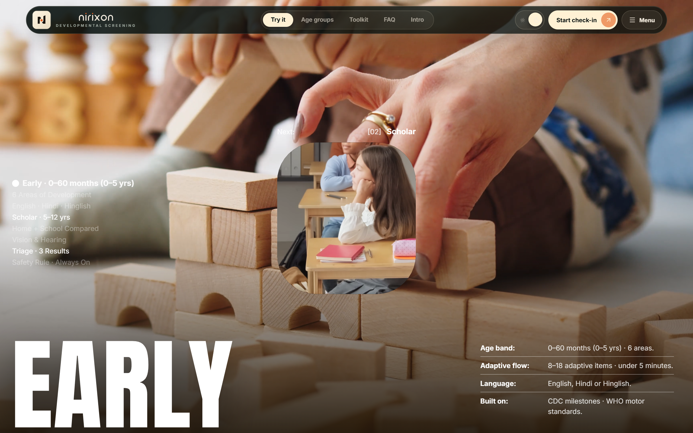

*Public landing page: role-based entry, dual screening paths, and the live check-in preview.*

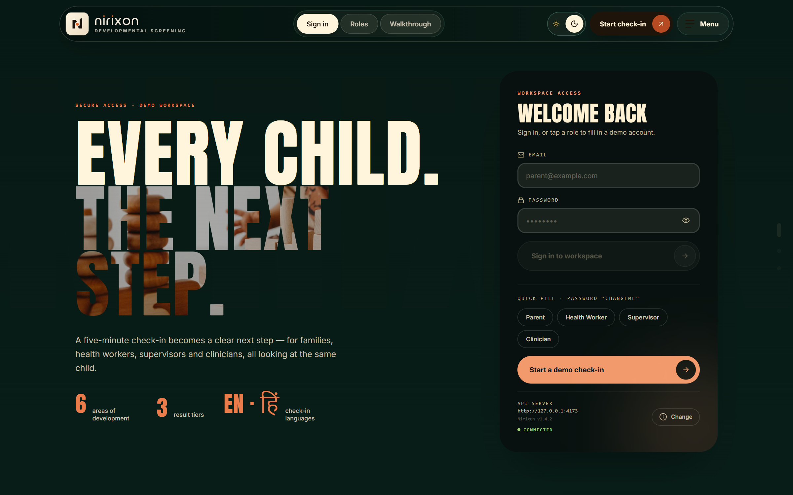

*Role-based sign-in with the API connection status and one-tap demo accounts.*

---

### 2. Caregiver Experience

#### Parent workspace

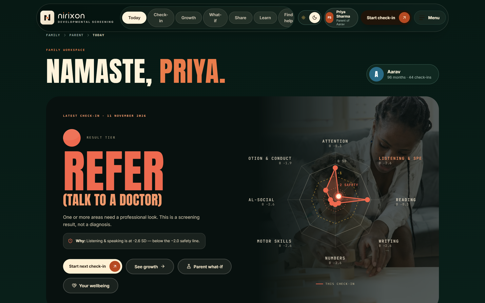

*Parent workspace: current check-in, growth snapshot, recent activity, and next actions.*

#### Check-in setup

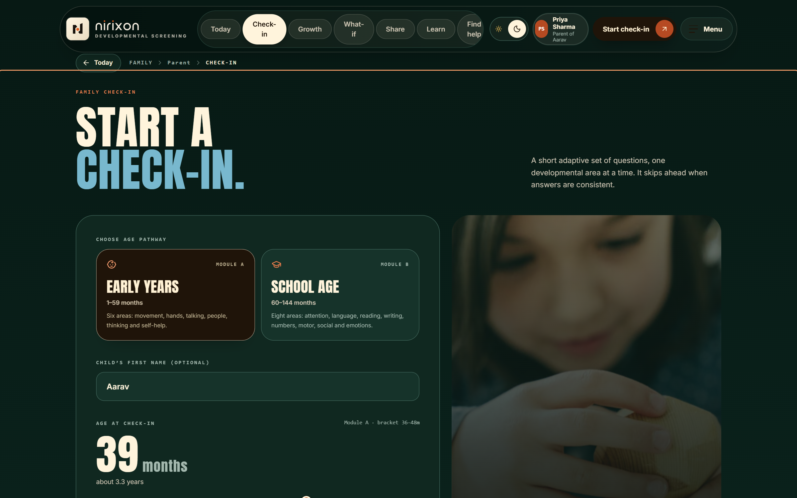

*Check-in setup: module choice, age, prematurity correction, child selection, and consent.*

#### Live check-in question

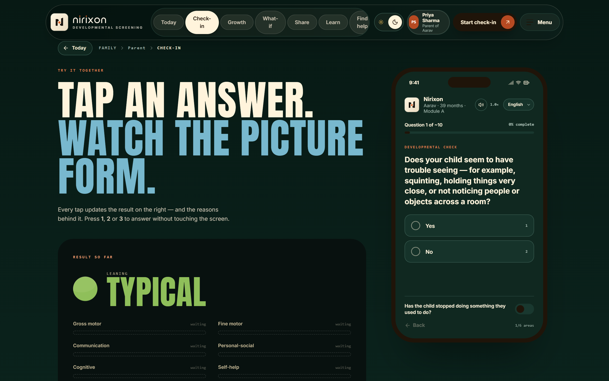

*Live question with narration controls, answer options, progress, and the running domain result.*

#### Growth and plateau tracking

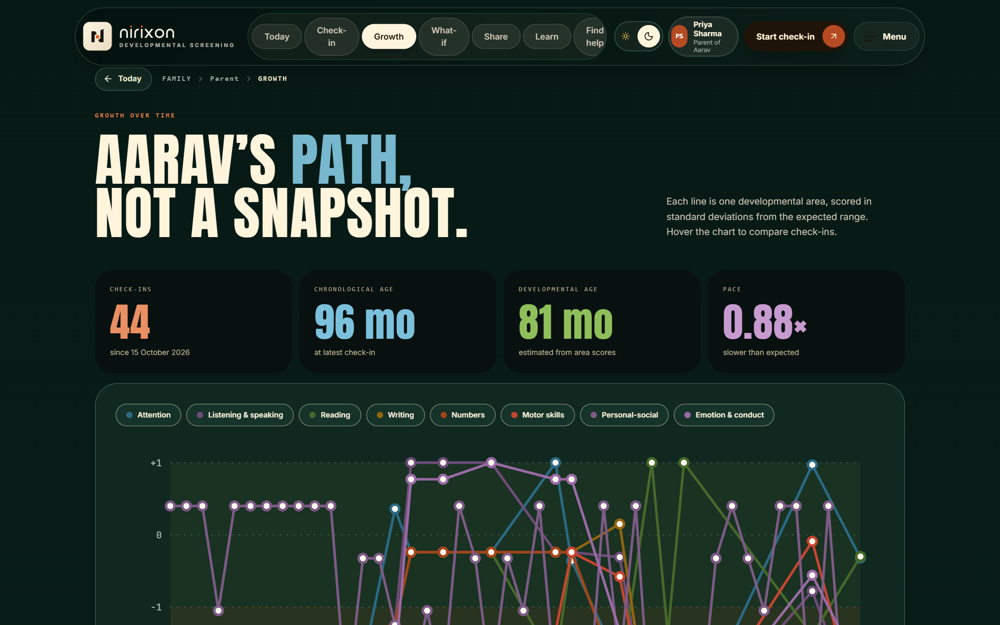

*Longitudinal growth curve, WHO cut-offs, developmental velocity, and plateau alerts.*

#### Joint-family concordance

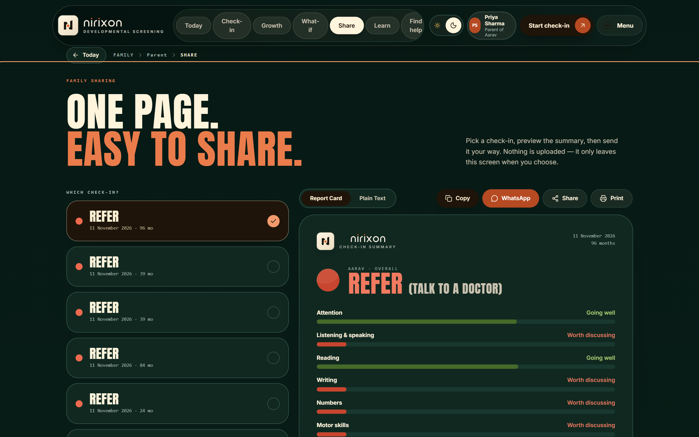

*Zero-login invite link/QR for a second caregiver or teacher, with concordance rules.*

#### Parent what-if

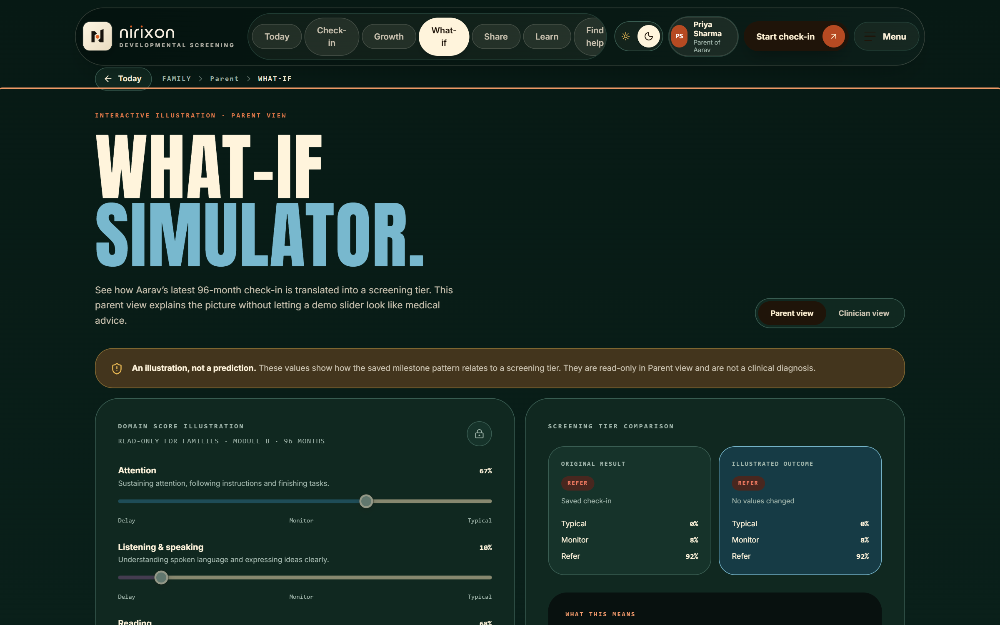

*Caregiver-facing explanation of how answers change the triage picture and SHAP factors.*

#### Find Help directory

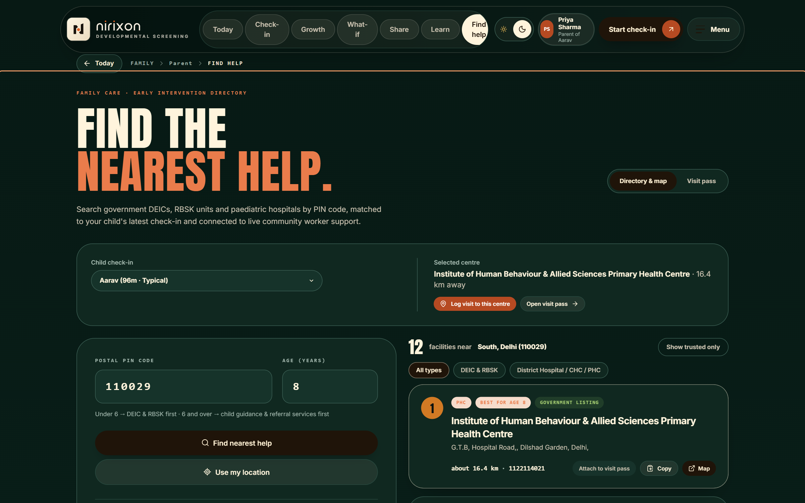

*PIN/GPS facility search, DEIC/RBSK/hospital filters, distance sorting, and visit-pass actions.*

---

### 3. Frontline Community Health Worker (ASHA / Anganwadi)

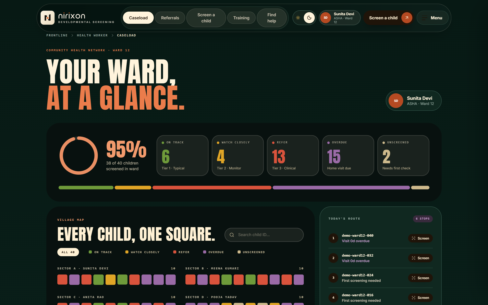

*Ward overview: 95% screened, tier counts, overdue visits, and first-check backlog.*

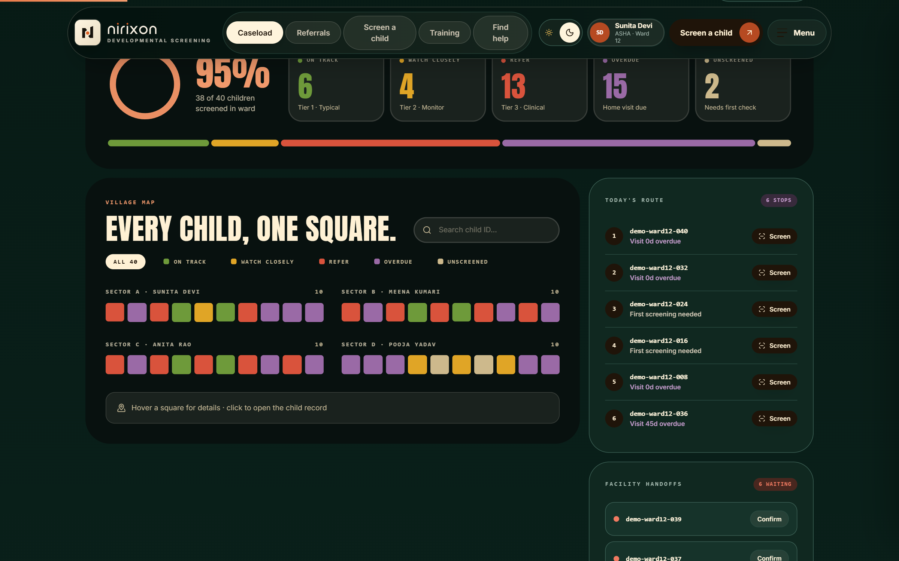

*Village map, sector grid, today's route, and facility handoffs for the assigned ward.*

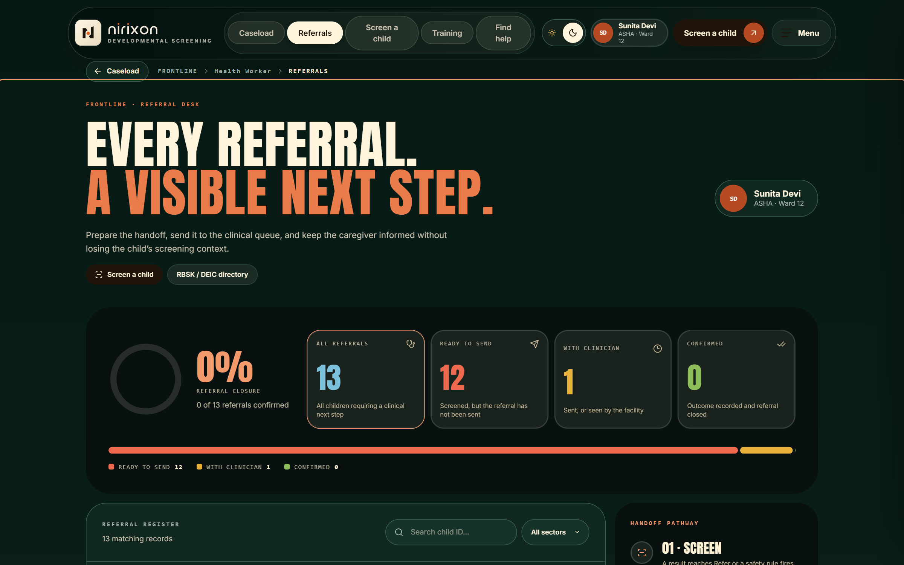

*Referral register: 5-stage lifecycle, safety overrides, review queue, and per-referral case notes.*

---

### 4. Clinician & Pediatric Specialist Portal

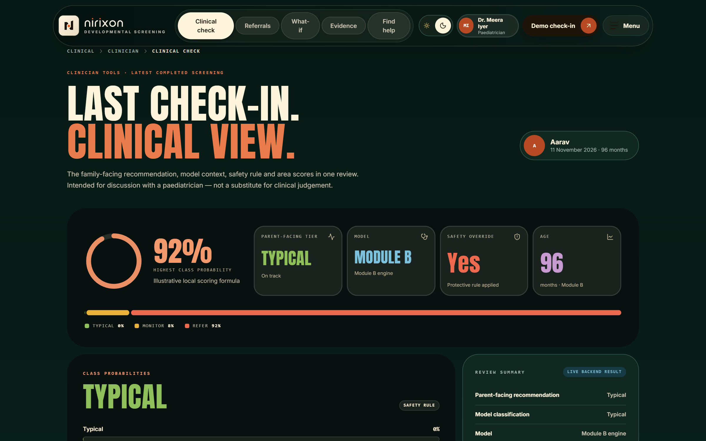

*Clinical check dashboard: referrals awaiting review, recent cases, and safety flags.*

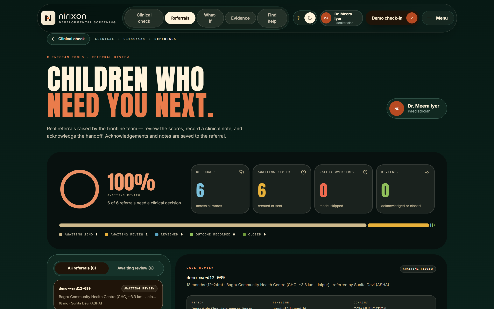

*Referral review: case list, reason/timeline/domains, acknowledge, and clinical note.*

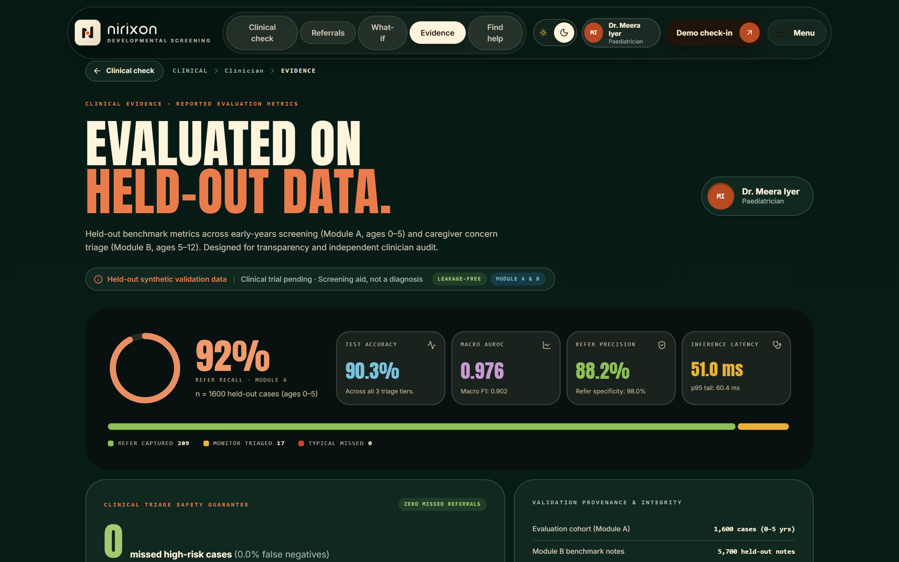

*Held-out evidence overview: 92.5% base RF Refer recall, 90.3% at the deployed threshold, 90.2% accuracy, 0.976 AUROC, 88.2% base precision, and 51 ms p50 latency.*

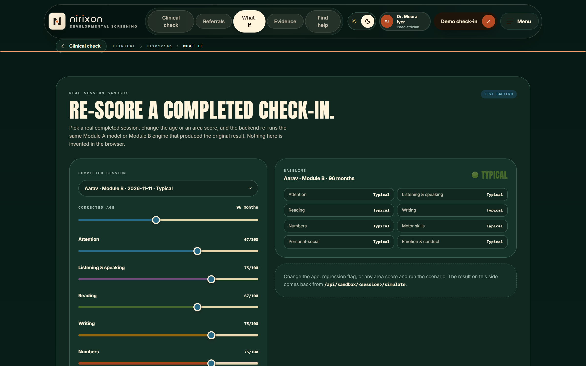

*What-if sandbox: load a completed session, perturb answers/age, and re-score with SHAP shifts.*

---

## ⚡ Evaluator Quick Start

You can run Nirixon using Docker Compose or via local Python + Node.js servers:

### Option A: Whole Stack with Docker Compose (Fastest)

```bash
# Start PostgreSQL, Redis, FastAPI Backend, and Nginx Frontend in one command
docker compose -f docker/docker-compose.yml up --build
```
- Web Application: **`http://localhost:3000`**
- API Documentation: **`http://localhost:8000/docs`**

---

### Option B: Local Development (Bare Metal)

```bash
# 1. Start Backend (Terminal 1)
cd backend
python -m venv .venv
# On Windows: .venv\Scripts\Activate.ps1 | On macOS/Linux: source .venv/bin/activate
pip install -r requirements-ml.txt -r requirements.txt
alembic upgrade head
uvicorn app.main:app --reload --port 8000

# 2. Start Frontend (Terminal 2)
cd frontend
npm install
npm run dev
```
- Frontend: **`http://localhost:5173`**
- Backend Swagger: **`http://localhost:8000/docs`**

#### Optional: Seed Realistic Ward Demo Data
```bash
cd backend
python scripts/seed_demo_data.py --ward "Ward 12" --count 40
```

> **Demo Accounts** (password for all: `changeme`):
> - **Parent / Caregiver:** `parent@example.com`
> - **ASHA Worker (Ward 12):** `chw@example.com`
> - **Field Supervisor:** `supervisor@example.com`
> - **Developmental Clinician:** `clinician@example.com`

---

## 📊 Feature Status & Verification Evidence

Every feature status below reflects the current automated or manual verification evidence:

| Feature / Subsystem | Category | Current Status | Test Suite Verification | Architectural & Clinical Notes |
|---|---|---|---|---|
| **Early Childhood Screening (Module A)** | Screening Engine | **Live · Verified** | `tests/test_end_to_end.py::test_e2e_flow_1_module_a_screening` | 0–60m adaptive IRT-inspired questionnaire, calibrated **Random Forest** inference (XGBoost/ensemble benchmarked), dynamic stopping, TreeSHAP attribution |
| **School-Age Screener (Module B)** | Screening Engine | **Live · Verified** | `tests/test_end_to_end.py::test_e2e_flow_2_module_b_screening` | 5–12y free-text NLP routing (TF-IDF + LogisticRegression), 8 developmental domains, 2 rule-outs, domain radar, 48 evidence-based home activities |
| **Deterministic Clinical Safety Floor** | Clinical Safety | **Live · Verified** | `tests/test_end_to_end.py::test_e2e_flow_3_safety_rule_bypass` | Milestone regression and severe deficit deterministic override forcing immediate Tier 3: Refer triage (overriding ML output) |
| **Interactive Facility Map & Directory** | Health Navigation | **Live · Verified** | `frontend/src/test/find-help.test.tsx` | OpenStreetMap tile slippy map with numbered badges, Haversine sorting by 6-digit PIN/GPS, trust provenance filters, two-column child rerouting card |
| **Clinical Evidence & Falsification Dossier** | Clinical Audit | **Live · Verified** | `frontend/src/views/Evidence.tsx` (`/api/evidence`) | 3×3 confusion matrix heatmap; oversight vitals (92.5% base RF Refer recall, 90.3% at the deployed 0.527 threshold, 88.2% base Refer precision, 90.2% accuracy, 0.976 AUROC); null controls; ASQ-style rule comparison (+14.5% relative macro-F1) |
| **Dual-Engine NLP Safety Intercept** | Clinical Safety | **Live · Verified** | `backend/tests/test_end_to_end.py` | Deterministic keyword safety floor plus rule-first router: **100% safety recall/precision** on the 122 held-out safety notes; the ML-only classifier had 0% safety recall |
| **Clinician "What-If" Simulation Sandbox** | Clinician Tools | **Live · Verified** | `tests/test_end_to_end.py::test_e2e_flow_4_what_if_simulation` | Real completed-session picker via `/api/sandbox/sessions`; post-hoc re-scoring via `/api/sandbox/{session_id}/simulate` with age/domain/answer overrides |
| **Community Health Worker Referral Lifecycle** | Community Health | **Live · Verified** | `tests/test_end_to_end.py::test_e2e_flow_5_referral_creation_to_outcome` | 5-stage auditable state machine (`created` ➔ `sent` ➔ `seen` ➔ `outcome recorded` ➔ `closed`), printable 4-field minimal PDF summary |
| **Caregiver & Facility Handoff** | Health Navigation | **Live · Verified** | `frontend/src/test/handoff.test.ts` | One-tap WhatsApp / SMS / copy handoff built from 4-field referral summary, plus helpline routing for feature phones |
| **Printable Slip & Caregiver Plan** | Health Navigation | **Live · Verified** | `frontend/src/test/print-sheet.test.ts` | Print-ready referral slip carrying a QR of the compact summary, plus a home-activity plan with bilingual chrome and native mobile printing |
| **Frontline Worker Caseload Dashboard** | Community Health | **Live · Verified** | `frontend/src/test/caseload.test.tsx` | Mobile-first 360px viewport, ward-wide caseload list, fast filters (tier, overdue, age), high-contrast touch targets |
| **Supervisor Programme Analytics** | Community Health | **Live · Verified** | `tests/test_referrals.py::test_supervisor_programme_analytics` | Area-scoped referral funnel, median screened→referral and referral→seen times, and per-ward coverage computed from real child records |
| **Offline-First Quick Actions** | Field Operations | **Live · Verified** | `tests/test_end_to_end.py::test_e2e_flow_6_offline_sync` | CHW quick-actions queued in IndexedDB when offline and replayed through `POST /api/chw/sync` (idempotent, conflict-logged) |
| **Follow-up Reminders** | Field Operations | **Live · Verified** | `backend/tests/test_notifications.py` | Follow-ups export as RFC-5545 `.ics` and delivered by the VAPID push sender / notification worker |
| **Multilingual Audio Narration** | Accessibility | **Live · Review-gated** | `tests/test_audio_narration.py` | 98 reviewed clips (Module A + mandatory flags, en-IN/hi-IN); 2,412 on-demand Hindi clips and on-demand narration in eight languages, returned flagged unreviewed until clinical sign-off |
| **Native Android Mobile APK** | Mobile Platform | **Live · Verified** | `frontend/android/app/build/outputs/apk/release/app-release.apk` (Capacitor 8, v1.4.2) | Offline-capable signed APK with native print manager, file-save/share bridge, safe-area layout, and first-run LAN/remote server configuration |
| **Area-Level Data Isolation & Privacy** | Data Governance | **Live · Verified** | `tests/test_referrals.py` | Zero cross-ward leakage; workers strictly restricted to their assigned village/ward; pseudonymous child tokens |
| **Multi-Caregiver Joint Family Triangulation** | Concordance | **Live · Verified** | `tests/test_share_merge.py` | Zero-login 72-hour invite links, zero-PII exposure, clinical combination rule (safety-maximized floor + statistical primary vector), Concordance Index ($0.0 - 1.0$) |
| **Longitudinal Growth & Plateau Tracking** | Growth Surveillance | **Live · Verified** | `tests/test_growth_sync.py` | Synced developmental age tracking, automated plateau alerts, WHO -2 SD cut-offs, right-to-erasure cascade (`DELETE /api/growth/data/{child_id}`) |
| **WhatsApp / SMS Follow-up Bot** | Messaging | **Live · Provider-gated** | `backend/tests/test_notifications.py` | Reminders for re-screening and referral status; consent, quiet hours, frequency caps and STOP/START opt-out |
| **Vision/Hearing Screen + Nutrition Flags** | Screening Engine | **Live · Verified** | `backend/tests/test_clinical_additions.py` | Sensory rule-outs force referral; MUAC and weight-for-age produce deterministic monitor/refer flags with disclaimers |
| **Caregiver Wellbeing (EPDS)** | Wellbeing | **Live · Review pending** | `backend/tests/test_clinical_additions.py` | Prematurity, screen time, home-learning context; EPDS module with item-10 safety path |
| **Frontline Training Mode** | Frontline Tools | **Live · Verified** | `frontend/src/test/training.test.tsx` | Curated sample cases with tier reveal and a 10-question quiz; progress stored on-device |

---

## 🛡️ Core Clinical Architecture & Safety Invariants

### 1. Three-Tiered Triage Model
Nirixon avoids binary "normal vs abnormal" labels in favor of an actionable, stigma-reduced 3-tier clinical classification:
- **Tier 1: Typical Development** — Milestone trajectory is on track. Caregivers receive positive reinforcement and age-appropriate developmental enrichment activities.
- **Tier 2: In-App Reflex Monitor** — Borderline or isolated domain lags. Triggers structured home activities and automated follow-up surveillance (e.g. 3-month re-screening).
- **Tier 3: Priority Referral** — Significant milestone deficits or red flags. Directs families to certified pediatric developmental centres (DEICs, Civil Hospitals).

### 2. The Deterministic Safety Floor Override
Statistical ML models can occasionally suffer from false reassurance on edge cases. Nirixon implements an inviolable **Clinical Safety Floor** that sits upstream and downstream of ML inference:
- **Milestone Regression:** Any reported loss of previously mastered milestones (speech, motor, social) triggers an immediate, non-negotiable **Tier 3: Refer** override.
- **Severe Milestone Deficit:** A verified motor or cognitive delay of $\le -2.0$ Standard Deviations overrides any probabilistic score.
- **Sensory & ASD Red Flags:** Critical vision/hearing non-responsiveness or early signs of social-communication withdrawal cannot be suppressed by typical scores in other domains.

```
       Caregiver Questionnaire Responses
                       │
         ┌─────────────┴─────────────┐
         ▼                           ▼
  [ML Risk Pipeline]     [Deterministic Safety Floor]
  (Calibrated Random Forest)   (Regressions, Severe Delays, Red Flags)
         │                           │
         │                     Positive Red Flag?
         │                     ├── YES ──► [TIER 3: REFERRAL OVERRIDE]
         │                     │           (Safety Notice & RBSK/DEIC)
         │                     └── NO
         ▼                          │
  [Predicted Risk Tier] ◄───────────┘
```

### 3. Prematurity Age Correction
To prevent healthy preterm infants from being incorrectly flagged as delayed, Nirixon dynamically calculates **Corrected Age in Months**:
$$\text{Corrected Age} = \text{Chronological Age} - \left( \frac{40 - \text{Gestational Weeks at Birth}}{4.33} \right)$$
Gestational age correction applies automatically for all infants under 24 months born before 37 weeks.

---

## 🧩 Dual-Module Screening Engines

### Module A: Early Childhood Screening (0–60 Months)

Designed for early identification of global developmental delays, cerebral palsy risk, autism spectrum indicators, and sensory deficits.

* **Clinical Item Bank:** Aligned with internationally recognized milestone domains:
  1. *Communication* (receptive and expressive language)
  2. *Gross Motor* (locomotion, posture, and balance)
  3. *Fine Motor* (pincer grasp, hand-eye coordination)
  4. *Problem Solving* (exploration, cause-and-effect cognition)
  5. *Personal-Social* (self-regulation, solitary/interactive play)
* **Adaptive Question Engine:** Evaluates domain uncertainty dynamically. Rather than overwhelming a parent with 60+ static questions, the session evaluates information gain and stops early (between 8 and 20 questions) when confident, while ensuring domain coverage requirements are satisfied.
* **Calibrated Inference & SHAP Explainability:**
  - Production model: **Random Forest Classifier** with probability calibration. It is selected by validation macro AUPRC with a tie-break toward lower latency/memory; XGBoost, Logistic Regression, and a soft-voting ensemble are benchmarked in `backend/ml/artifacts/MODEL_SELECTION.md`.
  - Every prediction yields a **TreeSHAP local attribution waterfall**, highlighting to clinicians and parents exactly which milestone answers contributed to the triage decision.

### Module B: School-Age Screener (5–12 Years)

Tailored for neurodevelopmental, behavioural, and learning challenges that emerge in academic settings.

* **NLP Free-Text Caregiver Intake:**
  - Caregivers describe concerns in their own natural language (e.g. *"Struggles to copy from blackboard and gets easily distracted"*).
  - The **Domain Router** (`TF-IDF` + `LogisticRegression` + clinical keyword safety guards) classifies initial priors across 8 domains and detects urgent safety keywords.
  - **Zero-PII Storage:** The raw text is wiped immediately after processing; only a SHA-256 hash is retained for audit deduplication.
* **8 Developmental & Educational Domains + 2 Rule-Outs:**
  1. *Attention & Work Habits* (Vanderbilt / INDT-ADHD aligned)
  2. *Emotion & School Conduct* (Strengths and Difficulties Questionnaire — SDQ)
  3. *Reading Fluency & Decoding* (DALI / NIMHANS SLD aligned)
  4. *Writing & Expression* (NIMHANS SLD aligned)
  5. *Mathematics & Numeracy* (NCERT / NIMHANS aligned)
  6. *Listening Comprehension & Speech*
  7. *Motor Coordination* (Developmental Coordination Disorder — DCDQ)
  8. *Social Participation & Peer Relations*
  - **Rule-Out 1: Sensory Triage** (Vision & Hearing rule-out checks)
  - **Rule-Out 2: Global Developmental & ASD Red Flags**
* **Acute Crisis Safety Flow:** Mentions of self-harm, extreme despair, or abuse immediately launch a dedicated safety notice displaying verified Indian toll-free crisis lines (Tele-MANAS, Kiran, Childline / RBSK).
* **Evidence-Based Home Activities:** Module B returns targeted, age-stratified practice activities (48 evidence-based protocols across academic and social domains) to guide caregivers immediately while awaiting clinical appointments.

---

## 👩‍⚕️ Community Health Worker (ASHA / Anganwadi / ANM) Ecosystem

Nirixon provides a full-featured, field-tested operations portal (`/referrals`, `/chw`) built specifically for India's frontline healthcare workforce: **ASHA Workers**, **Anganwadi Workers (AWW / ICDS)**, and **Auxiliary Nurse Midwives (ANM)**.

```
       [Field Tablet / Smartphone]
                   │
    ┌──────────────┴──────────────┐
    ▼                             ▼
Online Mode                  Offline Mode
(Direct REST)            (PWA Service Worker + IndexedDB)
    │                             │
    │                    [Offline Sync Queue]
    │                             │ (Auto-reconnect)
    └──────────────┬──────────────┘
                   ▼
         POST /api/chw/sync
                   │
    ┌──────────────┴──────────────┐
    ▼                             ▼
Idempotency Check         Conflict Detection & Resolution
(UUID Keys)               (Server State vs Client Payload)
                   │
                   ▼
       [Isolated Ward Database]
```

### Frontline Worker Dashboard
- **Low-Literacy & High-Contrast Interface:** Accessible design featuring high-contrast touch targets, self-explanatory iconography, and simplified terminology for field tablets.
- **Roster Management:** Instant filtering by Village/Ward, Triage Tier, and Overdue Home Visits.
- **Home Visit Cadence:** Automated calculation of 30-day, 60-day, and 90-day follow-up schedules.

### Offline-First Progressive Web App (PWA) Architecture
Frontline workers routinely visit remote rural hamlets and congested urban settlements without cellular data:
- **Client Storage (`IndexedDB`):** Queued quick-actions and the cached caseload are written to the browser's persistent IndexedDB database `nirixon-chw-offline` (object stores `queue` and `cache`).
- **Idempotency Guarantee:** Every queued operation contains a client-generated UUID `idempotency_key`. Retrying synchronization across flaky 2G/3G connections will never create duplicate child records or split referrals.
- **Conflict Resolution Engine:** When client state diverges from server state, the server resolves conflicts using domain precedence rules and logs the audit event in the `conflict_logs` table.
- **Shared Device Security:** Multiple workers sharing a primary health center tablet can safely hand over devices: **logging out triggers an immediate, irreversible wipe (`clearAllOfflineData()`)** of all local caches.

### One-Touch Referrals, WhatsApp Integration & RBSK/DEIC Handoff
- **One-Touch Creation:** Instant conversion of a flagged screening into an official referral packet.
- **WhatsApp Direct Sharing:** Generates pre-formatted bilingual referral summaries formatted for WhatsApp Web/App, allowing immediate handoff to parents or supervisors.
- **Printable Clinical PDF Slips:** Generates clean, printer-friendly referral slips conforming to government DEIC intake documentation.
- **Strict 5-Stage Auditable Lifecycle:**
  $$\text{created} \longrightarrow \text{sent} \longrightarrow \text{seen} \longrightarrow \text{outcome recorded} \longrightarrow \text{closed}$$
  Outcomes cannot be recorded until a child is formally marked as *seen* at the health facility.

### Area-Level Data Isolation & Privacy Invariants
- **Catchment Boundary Isolation:** Workers are bound to specific administrative zones (e.g. `Ward 12`, `Rampur Village`).
- **Zero Cross-Ward Leakage:** REST endpoints enforce strict `SELECT` and `INSERT` constraints based on the authenticated worker's assigned area. Cross-ward queries return HTTP 403 Forbidden.
- **Zero-PII Child Model:** Children are identified exclusively by pseudonymous tokens (e.g. `child-98f2a1b7`). No child names, parental contact numbers, or exact birthdates are stored in central referral tables.

---

## 👨‍👩‍👧‍👦 Multi-Caregiver Triangulation & Joint Family Concordance

In South Asian and joint-family households, developmental observations often vary between mothers, fathers, grandparents, and daycare educators:
- **Zero-Login Caregiver Invites:** The primary caregiver can generate an expiring, single-use public link (`/joint-invite/{token}`) for up to 3 secondary respondents.
- **Zero PII Exposure:** The respondent sees only the specific milestone questions—never the child's demographic information, parent identity, or previous answers.
- **The Clinical Combination Rule:**
  1. **Safety Maximization:** The *most concerning answer* given across all respondents is fed into the deterministic safety floor (ensuring that a grandmother's or mother's noticed red flag is never diluted or averaged away).
  2. **Statistical Stability:** The primary caregiver's consistent responses feed the statistical ML feature vector.
- **Item-Level Concordance Metric:** The system calculates a mathematical Concordance Index ($0.0 - 1.0$) highlighting specific items with parental disagreement, generating structured prompts for pediatric clinical discussions.

---

## 📈 Longitudinal Growth & Developmental Velocity Tracking

Nirixon provides an optional, opt-in synced developmental age tracking subsystem (`/growth`):
- **Developmental Age vs Chronological Age:** Calculates developmental velocity across sequential home visits.
- **The Plateau Detection Rule:** If a child's developmental trajectory plateaus (zero gain in developmental age over 3–6 chronological months), an automated alert prompts the caregiver and assigned health worker to schedule an early clinical reassessment.
- **Full Right to Erasure:** In strict adherence to India's **DPDPA 2023** and **GDPR**, caregivers can trigger complete, permanent deletion of their child's longitudinal history at any time (`DELETE /api/growth/data/{child_id}`).
- **Data Portability:** Full JSON export of growth trajectories (`GET /api/growth/export/{child_id}`) without proprietary lock-in.

---

## 🏥 Find Help Directory & Interactive Facility Map

Nirixon features a real-time, interactive directory of verified public and charitable developmental health centers across India:
- **Verified Facility Types:**
  - **DEIC (District Early Intervention Centres)** under the National Health Mission (NHM).
  - **RBSK (Rashtriya Bal Swasthya Karyakram)** Mobile Pediatric Health Teams.
  - **Civil & District Hospitals** with specialized pediatric departments.
  - **Composite Regional Centres (CRC)** & National Apex Institutes (e.g., NIEPID, NIMHANS, AIIPMR).
- **Interactive OpenStreetMap Slippy Map (`FacilityMap.tsx`):**
  - Dependency-free slippy map using OpenStreetMap raster tiles (no Leaflet bundle, no proprietary Google Maps API keys required).
  - Numbered, color-coded map markers synchronized with facility cards (`DEIC` in sea blue, `RBSK` in moss green, `Hospital` in amber).
  - User/PIN center pin with radial proximity boundary circle.
  - Smooth pan-to and fit-bounds animation upon card selection or postal PIN code lookup.
  - Accessible controls: zoom, marker tooltips, and fallback handling when offline or without GPS.
- **Geospatial Lookup:** Instant query via **6-digit Indian Postal PIN Code** or **GPS Coordinates** (using Haversine distance sorting via `/api/help/nearby`).
- **Trust Provenance Filtering:**
  - Toggle between all facilities or **Trusted Only** (`Government listing` and `Verified` records).
  - Clear data provenance badges on every facility card showing data source and verification status.
- **Strict Clinical Age Routing:**
  - Children **under 6 years** are routed to DEICs and RBSK early intervention teams.
  - Children **ages 6 to 12** are routed to District Hospital pediatric units, CRCs, and specialized educational rehabilitation centers.
- **Two-Column Cross-Role Referral Rerouting Bridge:**
  - When viewed by a Frontline Health Worker, Supervisor, or Clinician, the directory renders an active referral handoff bridge card.
  - Select any child from the caseload (e.g., `demo-ward12-039`) and click **Reroute & send to pin** to immediately update the child's designated clinical referral destination with an auditable counter-referral clinical note.
- **National Emergency Fallbacks:** When no verified facility exists within radius, the system immediately returns verified toll-free helplines (Tele-MANAS, Kiran Mental Health Helpline, and CHILDLINE / RBSK).

---

## 📊 Clinical Evidence Dossier & Empirical Falsification Proof

Nirixon includes a transparent, reviewer-oriented **Clinical Evidence** portal (`/clinician/evidence` and `/api/evidence`) designed for peer-reviewers, healthcare regulators, and developmental pediatricians:

### 1. Executive Clinical Oversight Vitals
- **Refer Recall Donut Gauge:** **92.5%** for the base Random Forest at argmax; **90.3%** at the deployed 0.527184 threshold.
- **Core Held-Out Performance Vitals:**
  - **Test Accuracy:** **90.2%** across all 3 triage tiers (*Typical*, *Monitor*, *Refer*).
  - **Macro AUROC:** **0.976** (Macro F1: **0.902**).
  - **Refer Precision:** **88.2%** for the base RF at argmax; replaying the calibrated model at the deployed threshold yields **90.7%** (see [`docs/RESULTS.md`](docs/RESULTS.md)). **Refer Specificity 98.0%** base / **98.5%** deployed.
  - **Flagged share:** **14.1%** (225/1,600) at the deployed threshold.
  - **Inference Runtime:** Production Random Forest median **51.0 ms** (p95 **60.4 ms**, p99 **64.7 ms**) for a single-row `predict_proba()`; the XGBoost benchmark is 16.5 / 21.0 / 24.2 ms.
- **Two decision policies, never mixed:** the model-selection table reports the **base RF at argmax**; the deployed system uses the **calibrated RF + threshold**. See [`docs/RESULTS.md`](docs/RESULTS.md) Table 7.2.

### 2. Clinical Triage Safety Guarantee (Zero Missed Cases)
- **0 Missed Refer Cases (0.0% False Negatives in Typical):**
  - Of 226 children in the held-out cohort whose ground-truth state met referral criteria, the **base RF at argmax** captured **209 (92.5%)** for immediate specialist review and placed **17 (7.5%)** into active monitoring; the **deployed threshold** captured **204 (90.3%)** and placed **22 (9.7%)** into monitoring.
  - **Zero high-risk children were classified as Typical under either policy.**
  - Clear triage pathway: base `209 Refer / 17 Monitor / 0 Typical`; deployed `204 Refer / 22 Monitor / 0 Typical`.

### 3. Elevated 3×3 Confusion Matrix Clinical Heatmap
- **Concordant Diagonal (Moss Green):** Calm, non-alarmist sage/moss green styling reflecting true clinical agreement.
- **Off-Diagonal Divergence (Soft Amber/Peach):** Clear visual separation for triage shifts without misleading red error zones.
- **Critical Safety Cell Callout:** The `True Refer ➔ Predicted Typical` cell features an explicit `0 (0% Missed)` highlight.
- **Interactive Inspection:** Hovering over any cell reveals a plain-language clinical translation and highlights row/column headers. Toggle between **Raw Case Counts** and **Row Percentages**.

### 4. Scientific Falsification & Anti-Leakage Proof
- **Target Invariance via Null Controls (Must Collapse to Chance):**
  - Ground-truth labels are established on the unobserved latent developmental state ($-2.0$ SD / $-1.0$ SD ASQ-style cutoffs) before questionnaire measurement noise is added—never by a deterministic formula on item answers.
  - When labels are shuffled or inputs replaced with random noise, the model collapses toward chance (Refer AUPRC 0.098–0.170 vs 0.953 with signal; majority-class chance = 0.141), proving no target leakage in the tested pipeline.
- **ASQ-Style Clinical Rule Benchmark Comparison (same held-out cohort):**
  - **ASQ-style rule (36 items, −2 SD on any domain):** Macro F1 $0.787$, Refer Sensitivity $96.0\%$, Refer Precision $55.5\%$.
  - **Nirixon calibrated Random Forest (36 items):** Macro F1 $0.902$ (**+14.5% relative F1**, Refer Sensitivity $92.5\%$, Refer Precision $88.2\%$).
  - **Adaptive 12-item model + peer imputation (XGBoost imputation benchmark):** Macro F1 $0.841$, Refer Sensitivity $80.1\%$, Refer Precision $83.4$, **reducing caregiver questionnaire burden by 66%** versus the 36-item bank.

### 5. Module B Dual-Engine NLP & Safety Architecture
- **Engine 1 (Deterministic Safety Floor):** Achieves **100% crisis safety recall and precision** on the 122 held-out safety notes in `test(all, unseen)`; the same result holds for both `rules_primary` and `blend`.
- **Engine 2 (Statistical Domain Router):** On the 5,700-note held-out set, `rules_primary` achieves **94.8% any-domain hit rate** and **90.5% domain micro-recall** (macro F1 0.927).
- **Why Deterministic Safety Rules Are Mandatory:** On the same sets, the statistical classifier alone had **0% safety recall** because emergency keywords are rare statistical outliers. Nirixon therefore runs a deterministic rule scanner ahead of the model, guaranteeing safety-flag coverage while preserving multi-label domain flexibility.

---

## 🔬 Clinician "What-If" Simulation Sandbox

For developmental pediatricians, psychologists, and clinical researchers, Nirixon includes an advanced simulation environment (`/sandbox`):
- **Hypothetical Override Testing:** Load any completed screening session and re-run inference under modified conditions (e.g. *"What if the family history flag were positive?"* or *"What if gross motor score drops by 1 point?"*).
- **Live Model Comparison:** Compare predictions and calibration probabilities between the production Random Forest, XGBoost, and baseline Logistic Regression artifacts.
- **Real-Time SHAP Shifts:** Observe how individual answer changes dynamically alter global and local SHAP feature attribution values.

---

## 🎙️ Multilingual Audio Narration Engine

To guarantee equity across diverse literacy levels and regional linguistic communities, Nirixon includes a pre-recorded and synthesized audio narration engine (`/api/audio/*`):
- **Languages Supported / Ready:** English, Hindi (हिन्दी), Marathi (मराठी), Tamil (தமிழ்), Telugu (తెలుగు), Bengali (বাংলা), Gujarati (ગુજરાતી), Kannada (ಕನ್ನಡ).
- **Coverage Audit (`docs/AUDIO_COVERAGE_REPORT.md`):** 2,510 total items; **98 clinically reviewed pre-generated clips** (en-IN/hi-IN, 3.9% of the universe); **2,412 on-demand Hindi clips**; **0 items without any narration path**. On-demand clips are machine-generated and returned flagged **unreviewed** until clinical sign-off.
- **Strict Clinical Verification Gate:** Pre-recorded clips are hidden unless they carry an explicit `reviewed_by` and `reviewed_date`. Missing clips are synthesized in the requested language and remain labelled as pending clinical review.
- **No Runtime Translation:** Translation happens offline, never at request time. The frontend falls back to English with an `EN` badge when a reviewed/localized rendition is unavailable.
- **Offline behaviour:** the service worker pre-caches reviewed/cached clips. On-demand synthesis requires the API (and outbound network); otherwise the UI falls back to validated written text.

---

## 📱 Native Android Application (Capacitor 8 & Release APK)

Nirixon packages as a standalone, signed Android APK (`Nirixon-1.4.2-release.apk`, versionCode 7) built with **Capacitor 8** and Android Gradle. The current source of truth is `frontend/android/app/build/outputs/apk/release/app-release.apk`.

- **Offline-First Native Runtime:** Runs the full responsive React 19 bundle from the device assets without requiring an internet connection for core views.
- **Native Document Downloads & Printing (`src/lib/native.ts`):**
  - PDF referral slips, caregiver plans, `.ics` reminders, and text/CSV exports are handed to Android's share sheet because WebView anchor downloads are ignored (`downloadBlobFile`, `downloadTextFile`).
  - Native system printing (`printCurrentPage`, `printHtml`) uses Android's `PrintManager`/`PrintDocumentAdapter`.
- **Dynamic API Server Configuration:**
  - A first-run connection wizard and **Server Settings** dialog (`ServerSettings.tsx`) lets workers/supervisors configure the backend API host (LAN IP, USB-forwarded `127.0.0.1`, or a public HTTPS endpoint). The dialog opens automatically when `/api/health` is unreachable.
  - The effective API base and app version are shown on the sign-in screen; the login screen checks `/api/health` through the same `/api` proxy used by the web build.
- **Network Security & Permissions:** `network_security_config.xml` permits cleartext LAN development and HTTPS production; the manifest declares `INTERNET`, coarse/fine location (Find Help), and legacy storage for sharing exports. No camera permission is requested.
- **Build & install:** `npm run build:mobile` (in `frontend/`) then `gradlew.bat assembleRelease` (in `frontend/android/`). Distribution, signing, and public-host guidance are in [`frontend/HANDOFF.md`](frontend/HANDOFF.md).

---

## 🏗️ End-to-End System Architecture

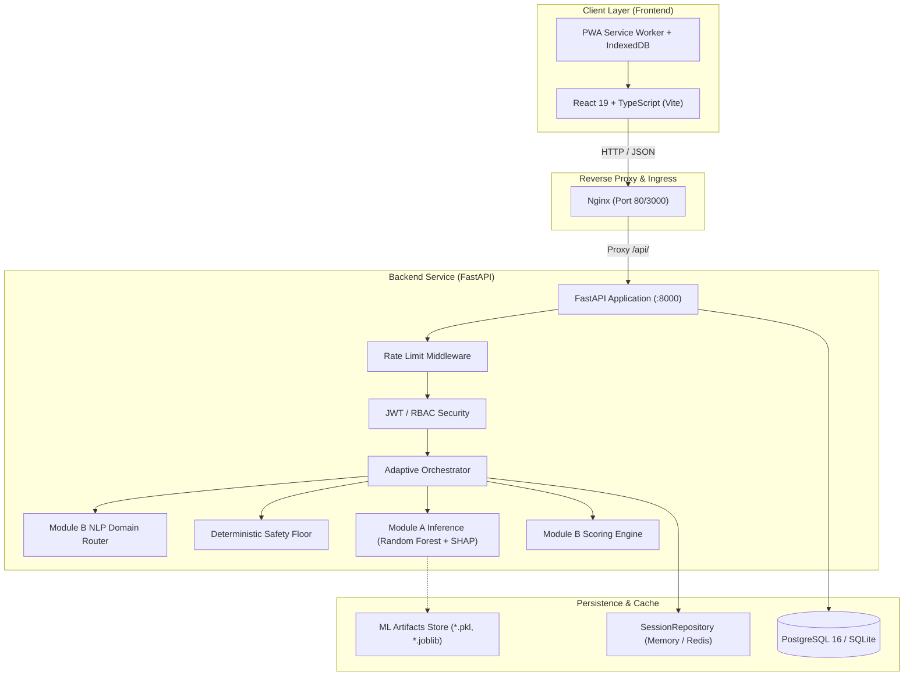

---

## 📡 Complete API Reference

Interactive Swagger documentation is available at `http://localhost:8000/docs` when running the backend.

### Authentication, Health & Meta
| Method | Endpoint | Access | Description |
|---|---|---|---|
| `POST` | `/api/auth/login` | Public | Authenticate user (parent, chw, supervisor, clinician) & receive JWT. |
| `GET` | `/health` | Public | Full health payload (DB, artifacts, Redis/session repo). |
| `GET` | `/api/health` | Public | Same payload under `/api`, so Vite/nginx proxies forward it. |
| `GET` | `/live` | Public | Process liveness only; independent of DB/artifacts. |

### Screening Core (Modules A & B)
| Method | Endpoint | Access | Description |
|---|---|---|---|
| `POST` | `/api/screen/start` | Parent | Initialize a new adaptive screening session with explicit consent. |
| `POST` | `/api/screen/{id}/intake` | Parent | Submit free-text concern (Module B) for NLP domain routing. |
| `POST` | `/api/screen/{id}/recall` | Parent | Select guided recall chips when the free-text concern was ambiguous (`/b/recall` also accepted). |
| `POST` | `/api/screen/{id}/answer` | Parent | Submit answer to pending item; returns next adaptive action. |
| `POST` | `/api/screen/{id}/regression` | Parent | Make the in-quiz regression toggle authoritative for the final result. |
| `GET` | `/api/screen/{id}/result` | Parent | Fetch completed triage result, domain breakdown, and SHAP factors. |
| `GET` | `/api/screen/{id}` | Parent | Inspect session state and audit metadata. |
| `GET` | `/api/screen/sessions` | Parent | The caller's own completed screening history. |
| `GET`/`POST` | `/api/screen/{id}/next` | Parent | Advance past informational notices (safety/recall), or fetch the next action. |
| `GET` | `/api/screen/{id}/teacher-items` | Parent | Module B items for the teacher form. |
| `POST` | `/api/screen/{id}/teacher` | Parent | Submit teacher answers for cross-context consistency scoring. |
| `GET` | `/api/screen/{id}/workers` | Parent | Suggested ASHA/Anganwadi/DEIC/RBSK workers. |
| `POST` | `/api/screen/{id}/contact_worker` | Parent | Log a request to connect with a worker. |
| `GET` | `/api/screen/touch-config` | Parent | Provisional touch-task reference ranges. |
| `GET` | `/api/screen/live-tasks/{bracket}` / `/{id}/live-tasks` | Parent | Direct-observation task definitions by age bracket/session. |
| `POST` | `/api/screen/{id}/touch-telemetry` | Parent | Touch-task telemetry (does not alter the final result). |
| `POST` | `/api/screen/{id}/reflex_branch` | Parent | Module B reflex/safety branch. |
| `POST` | `/api/predict` | Parent | Standalone inference endpoint for raw feature vectors. |

### Community Health Worker (CHW) System
| Method | Endpoint | Access | Description |
|---|---|---|---|
| `GET` | `/api/chw/workers/me` | Worker | Fetch profile and assigned village/ward of authenticated worker. |
| `GET` | `/api/chw/workers` | Worker/Supervisor | Worker roster for the scoped area. |
| `GET` | `/api/chw/tier-counts` | Worker/Supervisor | Tier counts for the ward dashboard. |
| `GET` | `/api/chw/analytics` | Worker/Supervisor | Area-scoped coverage and referral analytics. |
| `GET` | `/api/chw/conflicts` | Worker | Conflict log produced by offline sync. |
| `POST` | `/api/chw/children` | Worker | Register pseudonymous child record with explicit caregiver consent. |
| `GET` | `/api/chw/children` | Worker | Query child roster within worker's assigned area (supports tier filters). |
| `GET` | `/api/chw/children/{id}` | Worker | Fetch child profile, follow-up dates, and flag summaries. |
| `DELETE`| `/api/chw/children/{id}` | Worker | Erase child record and purge associated referrals (Right to Erasure). |
| `POST` | `/api/chw/children/{id}/contact` | Worker | Log completed home visit contact and update follow-up cadence. |
| `POST` | `/api/chw/children/{id}/outcome` | Worker | Record post-referral evaluation findings and update triage tier. |
| `POST` | `/api/chw/children/{id}/one-touch-referral` | Worker | Fast-track one-click referral generation. |
| `POST` | `/api/referrals` | Worker | Create formal clinical referral to DEIC or health facility. |
| `GET` | `/api/referrals` | Worker | List referrals within assigned area with status filtering. |
| `PATCH`| `/api/referrals/{id}` | Worker | Update referral status (`sent`, `seen`, `outcome recorded`, `closed`). |
| `GET` | `/api/referrals/{id}/summary` | Worker | Export minimal 4-field referral summary (JSON, PDF, shareable text). |
| `GET` | `/api/referrals/{id}/summary/pdf` / `/summary/text` | Worker | Printable PDF or plain-text summary. |
| `POST` | `/api/referrals/{id}/outcome` | Worker | Record the facility outcome. |
| `POST` | `/api/referrals/{id}/acknowledge` | Clinician | Acknowledge the handoff and optionally add a clinical note. |
| `POST` | `/api/referrals/{id}/send` | Worker | Dispatch via the configured provider. |
| `POST` | `/api/chw/sync` | Worker | Batch sync offline-queued actions with idempotency keys & conflict handling. |

### Multi-Caregiver Triangulation (Joint Family)
| Method | Endpoint | Access | Description |
|---|---|---|---|
| `POST` | `/api/share/session/{id}/invite` | Parent | Generate an expiring, single-use respondent link for a relative/teacher. |
| `GET` | `/api/share/session/{id}/invites` | Parent | List active and completed invites. |
| `GET` | `/api/share/invite/{token}` | Public | Fetch questionnaire items for secondary respondent (zero PII exposed). |
| `POST` | `/api/share/invite/{token}/respond` | Public | Submit responses from secondary caregiver. |
| `GET` | `/api/share/session/{id}/concordance` | Parent | Calculate item-level Concordance Index and list parenting disagreements. |
| `POST` | `/api/share/session/{id}/merge` | Parent | Execute combination rule (safety floor gets worst-case; ML gets primary). |
| `DELETE` | `/api/share/session/{id}` | Parent | Permanently delete the session and respondent answers. |

### Longitudinal Growth Tracking
| Method | Endpoint | Access | Description |
|---|---|---|---|
| `GET` | `/api/growth/status` | Public | Verify server growth syncing status and privacy constraints. |
| `POST` | `/api/growth/visits` | Parent | Record an opt-in pseudonymous growth visit snapshot. |
| `GET` | `/api/growth/visits/{child_id}`| Parent | List longitudinal history for a pseudonymous child ID. |
| `GET` | `/api/growth/analysis/{child_id}`| Parent | Compute developmental velocity and evaluate Plateau Rule. |
| `GET` | `/api/growth/export/{child_id}` | Parent | Export portable JSON record of all visits and velocity metrics. |
| `DELETE`| `/api/growth/data/{child_id}` | Parent | Permanently purge all server-stored growth data for child. |

### Healthcare Directory & Geolocation
| Method | Endpoint | Access | Description |
|---|---|---|---|
| `GET` | `/api/help/nearby` | Public | Find nearest verified DEICs, RBSK units, or Hospitals by PIN or GPS. |
| `GET` | `/api/facilities` | Public | Facility directory by PIN or lat/lng, with age/result/type filters and verified-only mode. |

### Clinician Sandbox & Clinical Evidence
| Method | Endpoint | Access | Description |
|---|---|---|---|
| `GET` | `/api/sandbox/sessions` | Clinician | Completed sessions available to the real what-if picker (cross-family, read-only). |
| `POST` | `/api/sandbox/{id}/simulate` | Clinician | Re-score a real session with answer/domain/age overrides. |
| `GET` | `/api/evidence` | Clinician | Retrieve held-out evaluation metrics, 3×3 confusion matrix, null controls, ASQ-style benchmarks, and Module B router performance. |

### Audio Narration & Accessibility
| Method | Endpoint | Access | Description |
|---|---|---|---|
| `GET` | `/api/audio/item/{id}` | Public | Retrieve audio narration metadata for an item and language. |
| `GET` | `/api/audio/manifest` | Public | Fetch entire reviewed audio catalog for offline preloading. |
| `GET` | `/api/audio/report` | Public | Audit clinical audio coverage across languages and banks. |

### Caregiver Wellbeing, Notifications & Voice
| Method | Endpoint | Access | Description |
|---|---|---|---|
| `GET` | `/api/maternal/questions` | Parent | EPDS questions. |
| `POST` | `/api/maternal/score` | Parent | Score EPDS answers (item 10 has an urgent safety path). |
| `GET` | `/api/maternal/history` | Parent | Prior EPDS results. |
| `GET` | `/api/notifications/vapid-public-key` | Public | Web Push public key and enabled flag. |
| `POST` | `/api/notifications/subscribe` / `unsubscribe` | Parent | Manage a push subscription. |
| `GET`/`PUT` | `/api/notifications/preferences` | Parent | Reminder channels, consent, quiet hours, lead days. |
| `GET` | `/api/notifications/` | Parent | Delivery/outbox history. |
| `POST` | `/api/notifications/test` / `run-sweep` | Parent/Admin | Queue a test or run the reminder sweep. |
| `POST` | `/api/notifications/whatsapp/webhook` / `status` | Provider | WhatsApp delivery callbacks and STOP/START. |
| `GET` | `/api/voice/twiml/inbound` / `twiml/outbound/{token}` | Provider | Twilio IVR TwiML. |

> The tables above cover the main endpoints. The complete, generated contract is available at `/docs` (Swagger), `/redoc`, or in [`docs/openapi.json`](docs/openapi.json).

---

## 🔒 Privacy, Ethics & Regulatory Compliance (DPDPA / HIPAA)

Nirixon was architected from inception to meet India's **Digital Personal Data Protection Act (DPDPA 2023)**, **ICMR Guidelines for Biomedical Research Involving Children**, and international **HIPAA** principles:

1. **Pseudonymous Referral & Growth Records:** Children are referenced in referral and growth tables by cryptographic UUIDs/tokens (e.g. `child-c9f1a238`). Exact birthdates are not stored; children are grouped into developmental age brackets (`18-24m`, `24-30m`). A screening session may optionally store a caregiver-entered display name, phone, or location for the family's own record; these fields are **not** included in the four-field referral handoff and are removed by the erasure workflow.
2. **Explicit, Timestamped Consent:** No screening, growth sync, or community referral can begin without active, recorded caregiver opt-in consent (`consent_recorded_at`).
3. **Right to Erasure (DPDPA Sec. 12):** Caregivers retain unconditional control. Deleting a child's record irreversibly purges screening answers, risk assessments, referrals, and growth visits via cascading database triggers.
4. **Minimal Referral Handoff Standard:** The generated referral summary transmitted to external specialists contains **strictly four non-identifying fields**:
   - Age Bracket (e.g., `18-24m`)
   - Triage Tier (e.g., `Tier 3: Direct Referral`)
   - Domains of Concern (e.g., `['motor', 'communication']`)
   - Triggered Safety Rule (e.g., `'Loss of motor milestones (SD <= -2.0)'`)
5. **Ephemerality of Free-Text Concerns:** Caregiver raw text descriptions submitted to Module B are processed in-memory by the NLP tokenizer and discarded immediately. Only a SHA-256 hash is retained for idempotent request deduplication.
6. **JWT Storage Trade-Off:** The web/PWA and Android WebView store the JWT in `localStorage` so a field worker is not signed out on every reload or app restart. Logout removes it, and 401 responses drop it. This is a deliberate usability trade-off; an HttpOnly-cookie deployment would be stronger against XSS but is not used by this client.

---

## 💻 Installation & Local Development

### Prerequisites
- **Python:** 3.10–3.13
- **Node.js:** v18.0.0 or higher (v20+ recommended)
- **Package Manager:** `npm` (or `pnpm` / `yarn`)
- **Docker & Docker Compose:** *(Optional, for containerized run)*
- **Android SDK + JDK 17+:** *(Optional, only for building the APK)*

---

### Step 1: Clone Repository & Configure Environment

```bash
git clone https://github.com/kirtankumarsanghi/Nirixon.git
cd Nirixon

# Copy environment template
cp .env.example .env
```

Review `.env` settings. The default configuration uses an asynchronous SQLite database (`nirixon_dev.db`), which requires no external database service:
```ini
ENVIRONMENT=development
DATABASE_URL=sqlite+aiosqlite:///./backend/nirixon_dev.db
JWT_SECRET=dev-only-change-me
SESSION_REPO_BACKEND=memory
ML_ARTIFACTS_DIR=backend/ml/artifacts
RATE_LIMIT_ENABLED=true
```

**Key environment variables**

| Variable | Purpose | Development default |
|---|---|---|
| `ENVIRONMENT` | `development` / `production`; controls dev-only behaviour | `development` |
| `DATABASE_URL` | Async SQLAlchemy URL; SQLite locally, Postgres in production | `sqlite+aiosqlite:///./backend/nirixon_dev.db` |
| `JWT_SECRET` | Token signing key; **must be a long random value in production** | `dev-only-change-me` |
| `SESSION_REPO_BACKEND` | `memory` for one worker, `redis` for multi-worker | `memory` |
| `REDIS_URL` | Shared session/rate-limit backend | unset |
| `ML_ARTIFACTS_DIR` | Directory containing `model.pkl`, `metrics.json`, `refer_threshold.json` | `backend/ml/artifacts` |
| `CORS_ORIGINS` | Comma-separated allowed web origins | localhost origins |
| `RATE_LIMIT_ENABLED` | Enables the API rate limiter | `true` |
| `SEED_USER_PASSWORD` | Parent demo password at first seed | `changeme` |
| `VAPID_*` | Web Push key pair (web/PWA only) | unset |
| `WHATSAPP_*` / `TWILIO_*` | Optional WhatsApp/SMS/IVR providers | unset |

Never commit `.env`. Use the platform's secret store on Render/Railway/VPS.

---

### Step 2: Backend Setup & ML Artifact Generation

```bash
# Create and activate Python virtual environment
python -m venv .venv

# On Linux/macOS:
source .venv/bin/activate
# On Windows (PowerShell):
.venv\Scripts\Activate.ps1

# Install backend dependencies & ML libraries
pip install -r backend/requirements-ml.txt -r backend/requirements.txt

# Train Module A calibrated ML model and generate artifacts
cd backend/ml
python train.py
cd ../..

# Apply database schema migrations via Alembic
cd backend
alembic upgrade head
cd ..
```

---

### Step 3: Run the FastAPI Backend Service

```bash
cd backend
# Web-only local run:
uvicorn app.main:app --reload --port 8000 --workers 1

# Phone/LAN run (bind all interfaces):
uvicorn app.main:app --host 0.0.0.0 --port 8000 --workers 1
```
*The API is now live at `http://localhost:8000`. Test `/api/health` (or `/health`) to confirm the database and ML artifacts are loaded. On Windows, `run-backend.bat` at the repo root starts the LAN-bound server with the correct venv path.*

---

### Step 4: Frontend Setup & Local Development Server

In a new terminal window:

```bash
cd frontend

# Create frontend environment file
cp .env.example .env

# Install dependencies
npm install

# Start Vite development server
npm run dev
```

*The parent-facing application and CHW portal are now accessible at `http://localhost:5173`.*

### Step 5 (optional): Android Mobile App (Capacitor)

The native app is the same React bundle. A phone cannot reach `127.0.0.1`, so
start the API on every interface and point the app at your computer's LAN IP:

```bash
# Terminal 1 — API reachable from the phone
cd backend
uvicorn app.main:app --host 0.0.0.0 --port 8000

# Terminal 2 — rebuild the bundle, sync it into Android, and package the signed APK
cd frontend
npm run build:mobile          # tsc + vite build + cap sync android
cd android
gradlew.bat assembleRelease   # macOS/Linux: ./gradlew assembleRelease
```

Install `frontend/android/app/build/outputs/apk/release/app-release.apk` (version 1.4.2, signed), then enter `http://<computer-LAN-IP>:8000` in the first-run server dialog (or tap **Change** on the sign-in screen). If Android reports “App not installed,” uninstall the old Nirixon build first (signature/cache mismatch), then install the release APK. To bake the address into the build instead:

```bash
VITE_MOBILE_API_BASE_URL=http://192.168.1.20:8000 npm run build:mobile
```

For a public deployment that works on **any** network (Render/Railway/VPS + managed Postgres), see [`docs/DEPLOY.md`](docs/DEPLOY.md) and the included [`render.yaml`](render.yaml) blueprint.

### Troubleshooting

| Symptom | Check | Fix |
|---|---|---|
| Phone says **Server unreachable** | `curl http://<laptop-LAN-IP>:8000/api/health` from the laptop | Start with `--host 0.0.0.0`; allow the Python binary through the firewall; put phone and laptop on the same subnet. Campus/guest Wi-Fi often has **client isolation** — use a phone hotspot, `adb reverse`, or a public HTTPS deploy |
| Works on laptop but not phone | `127.0.0.1` means the phone itself | Use the laptop LAN IP, or `adb reverse tcp:8000 tcp:8000` and then `http://127.0.0.1:8000` |
| **App not installed** | Old debug signature vs new release signature | Uninstall the old Nirixon build, then install the signed release APK |
| Still seeing the old UI | Stale WebView assets/cache | Run `npm run build:mobile`, bump `versionCode`, uninstall, reinstall |
| `/health` returns 404 through Vite/Nginx | Proxy only forwards `/api` | Use `/api/health` (alias) or update the proxy |
| Render API crashes on boot | `DATABASE_URL` format | Use `postgresql+asyncpg://…?ssl=require`; the app normalizes managed-Postgres URLs |
| CORS error from a deployed frontend | `CORS_ORIGINS` | Add the exact `https://…` origin, no wildcard with credentials |
| Push toggle says unavailable | Android WebView has no service worker | Use WhatsApp/SMS/IVR on native; Web Push is for web/PWA |
| Module B results look different in the UI | Wrong policy row | The deployed policy is `rules_primary`; `/api/evidence` now reports that row |

---

## 🔑 Default Seed Credentials

During application startup, Nirixon automatically seeds standard accounts for testing and evaluation across all user personas:

| Persona / Role | Email | Password | Role Key | Assigned Territory / Notes |
|---|---|---|---|---|
| **Parent / Caregiver** | `parent@example.com` | `changeme` | `parent` | Standard family screening flow |
| **Frontline CHW (ASHA)** | `chw@example.com` | `changeme` | `chw` | Assigned to **Ward 12** (Sunita Devi) |
| **Field Supervisor** | `supervisor@example.com` | `changeme` | `supervisor` | Oversees **Ward 12** (Rekha Sharma) |
| **Frontline CHW (Ward 15)**| `chw_ward15@example.com` | `changeme` | `chw` | Assigned to **Ward 15** (Anjali Kumari — for cross-area testing) |
| **Clinician / Pediatrician**| `clinician@example.com` | `changeme` | `internal` | Unlocks What-If Simulation Sandbox |

> The parent account uses `SEED_USER_PASSWORD` from `.env` (default `changeme`). The CHW/supervisor/clinician demo accounts are seeded with the fixed demo password `changeme`, because the app’s one-tap role switcher uses it. Change the parent password before any public deployment, and treat a public instance as a **public demo** unless you add access control.

---

## 🐳 Docker, Render & Production Deployment

### Docker Compose
Nirixon includes a multi-container Docker Compose configuration for production-like local testing:

```bash
cd docker
docker compose up --build
```

### Services Started:
1. **`db`:** PostgreSQL 16 Alpine with persistent volume `nirixon_pg` on port `5432`.
2. **`redis`:** Redis 7 for the shared session repository (`SESSION_REPO_BACKEND=redis`).
3. **`api`:** FastAPI backend on port `8000`. Executes Alembic migrations automatically on boot before launching Uvicorn.
4. **`notifier`:** single-process reminder sweeper (kept separate so multi-worker API replicas do not double-send).
5. **`frontend`:** production Nginx container serving compiled static assets on port `3000` and reverse-proxying `/api/` and `/audio/` to the backend.

Access the complete containerized stack at `http://localhost:3000`.

### Managed / public deployment
For a phone app that works on **any** network (cellular or another Wi-Fi), deploy the backend publicly over HTTPS and bake the URL into the APK:

- **Render:** use [`render.yaml`](render.yaml) (Docker API + managed Postgres; migrations run on boot).
- **Railway / Fly.io / VPS:** use `docker/Dockerfile.backend` with managed Postgres and Redis.
- Full step-by-step guide, env reference, TLS, security notes, and troubleshooting: [`docs/DEPLOY.md`](docs/DEPLOY.md).

### Production security checklist

- [ ] Generate a new `JWT_SECRET` (32+ random bytes); never reuse `dev-only-change-me`.
- [ ] Change/disable the seeded demo accounts; do not expose `changeme` publicly.
- [ ] Use **managed Postgres**, not SQLite, and `SESSION_REPO_BACKEND=redis` if running more than one worker.
- [ ] Terminate TLS at the proxy/PaaS; never serve the API over plain HTTP on the public internet.
- [ ] Set `CORS_ORIGINS` to the exact frontend origin.
- [ ] Keep rate limiting enabled; add a reverse-proxy/WAF rate limit for auth.
- [ ] Store `JWT_SECRET`, DB URLs, VAPID, WhatsApp, and Twilio credentials in the platform secret store — not in git.
- [ ] Run `alembic upgrade head` on every deploy; verify `/api/health` and `/docs`.
- [ ] Configure database backups and log retention.
- [ ] Treat a public instance as a **demo**: no real child/family data without ethics approval and a DPDPA-compliant agreement.
- [ ] Rebuild the Android release with the public `VITE_MOBILE_API_BASE_URL`; keep the signing key backed up and out of git.

---

## 🧪 Test Suite & Quality Verification

Nirixon enforces automated testing across both backend Python modules and frontend React components:

### 1. Backend Pytest Suite
```bash
cd backend
pytest tests/ -q
```
- **27 test modules · 236 tests · 236 passing.**
- **End-to-End Verification:** Full user journey flows (Module A adaptive questionnaire, Module B NLP intake, deterministic safety floor override, completed session sandbox simulation, and 5-stage referral lifecycle).
- **Security & Multi-Tenant Boundaries:** Strict isolation across village/ward boundaries and child ID pseudonymity.
- **Audio & Geolocation:** Validation of reviewed multi-language audio assets and Haversine distance calculations.

### 2. Frontend Vitest, TypeScript & Lint
```bash
cd frontend
npm test          # Vitest: 17 files, 67 tests
npm run typecheck # tsc -b
npm run lint
npm run build
```
- **17 Vitest files · 67 tests passing:**
  - `find-help.test.tsx` (Facility directory, PIN code lookup, trusted filter, interactive map marker sync).
  - `caseload.test.tsx` (Frontline caseload dashboard, quick filters, ward-wide child registry).
  - `training.test.tsx` (Sample cases, practice quiz, tier reveal).
  - `handoff.test.ts` & `print-sheet.test.ts` (WhatsApp handoff, print-ready slips, native file exports).
  - `module-b-intake.test.tsx` (Free-text NLP intake, frequency scales, crisis safety alerts).
  - `partial-area-scores.test.tsx`, `growth-percentiles.test.ts`, `localization.test.tsx`, `oversight-hero.test.tsx`.
- **Mobile layout audit:** headless Chromium/Edge at **390px and 360px**, across all four roles and 22 routes, found **zero horizontal page overflow**. Touch-target (≥44×44) and physical safe-area verification remain a manual/device step.

### 3. Validation status (read before quoting metrics)

- **Canonical current metrics:** `backend/ml/artifacts/metrics.json` (Random Forest, 8,000-row synthetic cohort, 1,600-row holdout). See also `MODEL_SELECTION.md`, `refer_threshold.json`, and `model_disabled_demo.json`.
- **Current operating point:** `refer_threshold = 0.527184`, target recall 0.85 on validation; held-out **Refer sensitivity 0.9027 / specificity 0.9847 / macro F1 0.9018 / flagged 14.06%**.
- **Null controls:** signal Refer AUPRC 0.953; label shuffle 0.170; random features 0.098; permuted test 0.156; majority-class chance 0.141.
- **Model-disabled safety demo:** 10,000 held-out rows, 496 regression cases, **496/496 caught** by the rule + safety floor.
- **Content validity:** Lawshe CVR + cognitive-interview protocol and tooling exist; expert ratings are **pending** (`docs/content_validity_protocol.md`).
- **Clinical validation:** **not established**; prospective pilot is defined in `docs/pilot_study_protocol.md` and is pending.

---

## ⚠️ Known Limitations & Clinical Boundary Notices

Nirixon is engineered for transparent, responsible healthcare AI deployment. Evaluators, clinicians, and researchers should note the following explicit system boundaries:

### 1. Synthetic & Semi-Synthetic Training Data
The machine learning models (**calibrated Random Forest** for Module A and a TF-IDF/rule hybrid router for Module B) were trained and evaluated on synthetic and semi-synthetic developmental milestone distributions. **These numbers measure recovery of the generating rule, not clinical accuracy.** The current `metrics.json` run uses an 8,000-row cohort with a 1,600-row holdout; the generator can produce up to the 50,000-row full specification. Prospective clinical validation across socioeconomic, nutritional, and regional strata is defined in [`docs/pilot_study_protocol.md`](docs/pilot_study_protocol.md) and is currently pending institutional pilot deployment.

### 2. Clinical Review Pending (Screening vs Diagnostic Device)
Nirixon is strictly categorized as an **AI-assisted developmental screening and triage decision-support tool**.
- It is **NOT** an automated diagnostic device, software as a medical device (SaMD), or a replacement for comprehensive clinical examination.
- Every triage recommendation (*Typical*, *Monitor*, *Refer*) requires clinical correlation by certified healthcare professionals.
- Expert **content validity (CVR) and cognitive interviews are not yet run**; the protocol and analysis tooling are ready.

### 3. Module B Domain Precision Trade-Off
School-age parental free-text intake presents natural language variability. Nirixon tunes the NLP domain router for higher recall over precision so potential concerns are not missed. The `rules_primary` policy reports **100% safety recall** and **100% safety precision** on the current test set; the statistical classifier alone had 0% safety recall, which is why the deterministic scanner runs first.

### 4. Audio Review Coverage
Only **98 of 2,510 items (3.9%)** have clinically reviewed, pre-generated clips. The 2,412 Module B items (and other languages) are synthesized on demand and flagged **unreviewed** until clinical sign-off. The UI falls back to validated written text if audio cannot be produced.

### 5. Native Web Push
Web Push requires a service worker, which the packaged Android WebView intentionally does not run. The app therefore exposes WhatsApp/SMS/IVR reminder channels on native; the push toggle explains that it is unavailable in the app build. Web/PWA deployments can use Web Push.

---

## 🎬 Interactive Evaluation Demo Script

Follow this step-by-step walkthrough to reproduce every verified capability in Nirixon:

### Scenario 1: Early Childhood Screening (Module A — 18 Months)
1. **Navigate to the Screening Portal:** Open `http://localhost:5173/#/login` and log in as `parent@example.com` / `changeme`.
2. **Initialize Screening:** Select child age as **18 months**, toggle **Premature: No**, accept the opt-in **Consent Notice**, and select **Module A (0–60 Months)**.
3. **Audio Narration Bar:** Note the audio narration widget at the top. Click play to hear a reviewed English/Hindi prompt or an on-demand localized clip. Toggle playback speed between `0.8x` and `1.0x`.
4. **Adaptive Milestone Questions:** Answer the developmental milestone questions (Communication, Fine Motor, Problem Solving). Note that questions adapt dynamically based on previous responses.
5. **Results & SHAP Waterfall:** Upon completion, observe the **Typical**, **Monitor**, or **Refer** triage badge, along with domain score bars, TreeSHAP contribution factors, and home play activities.

### Scenario 2: School-Age Screener with Free-Text NLP (Module B — 8 Years)
1. **Start School-Age Session:** Return to `http://localhost:5173/#/parent/checkin` and choose **Module B (5–12 Years)**.
2. **Enter Caregiver Concern:** In the free-text intake textarea, type:  
   *"Teacher says he cannot sit still, gets easily distracted during class, and struggles with reading new words."*
3. **NLP Routing & Recall Chips:** The router automatically highlights **Attention & Work Habits** and **Reading Fluency** as initial priors.
4. **Adaptive Micro-Testing:** Answer the targeted micro-testing items.
5. **Radar & Activities:** Review the 8-domain radar chart visualizing domain scores, alongside evidence-based home activities for attention and decoding.

### Scenario 3: Deterministic Clinical Safety Floor & Crisis Bypass
1. **Trigger Safety Floor:** In Module A, answer a question indicating **developmental regression** (e.g., child previously had words and walked independently, but has now stopped speaking and lost motor coordination).
2. **Deterministic Override:** Notice that regardless of typical scores in other domains, the system immediately halts the session and issues a **Tier 3: Priority Referral** override.
3. **Emergency Notice:** The screen presents emergency helpline cards (Kiran, Tele-MANAS, Childline) and advises immediate clinical evaluation at the nearest DEIC.

### Scenario 4: Clinician "What-If" Simulation Sandbox
1. **Log in as Clinician:** Sign out and log in as `clinician@example.com` / `changeme`.
2. **Open Sandbox:** Navigate to `http://localhost:5173/#/clinician/whatif` or use the **What-if** tab in the Clinician workspace.
3. **Load Completed Session:** Select the previously completed screening session.
4. **Simulate Answer Perturbation:** Use the What-If sliders to modify an answer from *Yes* to *Not Yet*.
5. **Observe Real-Time Shift:** Click **Simulate**. The API re-scores the model instantly, showing the calibrated probability change, triage tier shift, and updated SHAP feature attribution waterfall.

### Scenario 5: Frontline Worker Low-Literacy Dashboard (ASHA / Anganwadi)
1. **Log in as Frontline CHW:** Sign in as `chw@example.com` / `changeme` (assigned to **Ward 12**).
2. **Access Dashboard:** Navigate to `http://localhost:5173/#/chw/caseload` (or the **Referrals** tab for `#/chw/referrals`).
3. **Filter Village Roster:** The dashboard lists every child in Ward 12.
4. **Test Quick Filters:**
   - Click the **Tier 3** badge to isolate high-risk children.
   - Click the **Overdue Follow-Up** chip to view children pending a 30-day home check.
   - Resize your browser window to **360px width** (mobile emulation): verify zero horizontal scrolling and large touch targets.
5. **One-Touch Referral Lifecycle:**
   - Tap **Refer to DEIC** on an unscreened or Tier 2 child.
   - Fill the minimal referral modal and click **Create Referral** (status becomes `created`).
   - Advance status: Tap **Mark Sent** (status `sent`), then **Mark Seen** (status `seen`).
   - Tap **Record Outcome**: Enter diagnostic confirmation (e.g., "Enrolled in DEIC Speech Therapy") and click Save (status `outcome recorded`, then `closed`).
   - Click **Generate Printable Summary**: Verify the clean one-page PDF/text summary containing strictly the 4 allowed fields (`age_bracket`, `tier`, `domains_of_concern`, `safety_rule_trigger`).

### Scenario 6: Offline PWA Field Mode & Idempotent Sync
1. **Go Offline:** Open Chrome DevTools > Network tab > check **Offline** (or toggle Wi-Fi off).
2. **Perform Offline Field Operations:**
   - In the CHW dashboard, click **Add Child**: Register a new child (`age_bracket: 24-30m`, consent checked). Notice the yellow offline badge: *"Saved to IndexedDB offline queue"*.
   - Tap **Refer to DEIC** on the newly registered offline child.
3. **Verify IndexedDB:** In DevTools > Application > IndexedDB > `nirixon-chw-offline`, inspect the `queue` object store to see the queued operations with client UUID idempotency keys.
4. **Reconnect & Sync:** In DevTools > Network tab > uncheck **Offline**. Click **Sync Now** (or let auto-sync trigger).
5. **Verify Idempotency:** The queue synchronizes all operations to `/api/chw/sync`. Click **Sync Now** again: confirm 0 duplicate records created.
6. **Device Handover Security:** Click **Logout**: verify that IndexedDB tables and CacheStorage are completely wiped, leaving zero child data on the device.

---

## 📁 Project Directory Layout

```
nirixon/
├── .env.example                 # Root configuration template
├── README.md                    # Comprehensive platform guide & UI showcase
├── ABOUT.md                     # Mission, clinical philosophy & public health context
├── ROADMAP.md                   # Product & clinical field trial roadmap
├── LICENSE                      # MIT Open Source License
├── Nirixon-1.4.2-release.apk    # Signed Android release APK (Capacitor 8)
├── render.yaml                  # Render blueprint: Docker API + managed Postgres
├── run-backend.bat              # Windows one-click LAN-bound API launcher
├── docker/                      # Container specifications
│   ├── Dockerfile.backend       # Python 3.12 container
│   ├── Dockerfile.frontend      # Multi-stage Vite build + Nginx container
│   ├── docker-compose.yml       # Stack: Postgres 16 + Redis + FastAPI + notifier + Nginx
│   └── nginx.conf               # SPA routing & /api + /audio proxy rules
├── docs/                        # Architectural documentation & specifications
│   ├── ARCHITECTURE.md          # End-to-end system and data flow
│   ├── ETHICS_AND_DATA.md       # Privacy, DPDPA 2023 & Consent governance
│   ├── AUDIO_COVERAGE_REPORT.md # Audio review/coverage audit
│   ├── RESULTS.md               # Report-ready Section 7 results tables
│   ├── VALIDITY.md              # Verification methodology; current numbers in metrics.json
│   ├── DEPLOY.md                # Render/Railway/VPS deployment & mobile URL baking
│   ├── PROJECT_DESIGN.md        # Design rationale
│   ├── content_validity_protocol.md # Lawshe CVR + cognitive interviews
│   ├── data_dictionary_items.md # Item-bank data dictionary
│   ├── module_b_integration.md  # 5–12 school-age integration mapping
│   ├── pilot_study_protocol.md  # Clinical field pilot protocol
│   ├── openapi.json             # Generated API contract
│   └── verification/            # UI screenshots & verification gallery
├── backend/                     # FastAPI Application Service
│   ├── alembic.ini              # Migration configuration
│   ├── requirements.txt         # Core API dependencies (FastAPI, SQLAlchemy, edge-tts)
│   ├── requirements-ml.txt      # ML dependencies (scikit-learn, XGBoost, SHAP)
│   ├── app/
│   │   ├── main.py              # Application entrypoint & lifespan events
│   │   ├── config.py            # Pydantic BaseSettings & env validation
│   │   ├── auth.py              # JWT authentication & password hashing
│   │   ├── core/                # Core screening, triage & referral services
│   │   │   ├── adaptive_tree.py # Dynamic item selection engine
│   │   │   ├── safety_floor.py  # Deterministic clinical safety floor
│   │   │   ├── nlp_router.py    # Free-text concern classifier
│   │   │   ├── worker_service.py# Community worker directory & logic
│   │   │   ├── referral_service.py # Lifecycle & PDF/WhatsApp formatting
│   │   │   ├── joint_family.py  # Multi-caregiver concordance & combination
│   │   │   ├── growth.py        # WHO milestone velocity & plateau checks
│   │   │   └── module_b/        # School-age questionnaire engine
│   │   ├── db/                  # Persistence (models, session, migrations)
│   │   ├── ml/                  # Inference wrappers (production model + TreeSHAP)
│   │   ├── routers/             # FastAPI routers (auth, screen, referrals, growth, help, audio, sandbox...)
│   │   └── schemas/             # Pydantic v2 validation models
│   ├── data/                    # Item banks, translations, facility reference DB
│   ├── ml/                      # Training/evaluation pipeline + artifacts
│   │   ├── train.py             # Training, calibration, fairness, model selection
│   │   ├── artifacts/           # model.pkl, metrics.json, threshold, SHAP explainer
│   │   └── evaluation/          # Null controls, stress tests, model-disabled demo
│   └── tests/                   # Pytest: 27 modules / 236 tests
└── frontend/                    # Vite + React 19 Frontend
    ├── package.json             # NPM dependencies & scripts
    ├── vite.config.ts           # Vite config, /api + /audio proxy, version injection
    ├── capacitor.config.ts      # Capacitor 8 Android packaging configuration
    ├── android/                 # Native Android Studio project (Capacitor bridge)
    │   ├── app/src/main/AndroidManifest.xml
    │   ├── app/src/main/java/com/nirixon/app/MainActivity.java
    │   └── app/src/main/res/xml/network_security_config.xml
    ├── src/
    │   ├── App.tsx              # Root router & workspace shell
    │   ├── store.tsx            # App context: auth, routing, data loading, toasts
    │   ├── api/                 # Typed fetch API client
    │   ├── landing/             # Cinematic public landing page
    │   ├── lib/
    │   │   ├── native.ts        # Android print/download/share bridge
    │   │   ├── i18n.ts          # 8-language chrome + phrase bank
    │   │   ├── model.ts         # Triage tiers & developmental domains
    │   │   └── roles.ts         # Role definitions & RBAC permissions
    │   ├── views/               # Home, CheckIn, Growth, Caseload, Referrals, Evidence...
    │   ├── components/
    │   │   ├── FacilityMap.tsx  # Dependency-free OSM raster-tile map
    │   │   ├── OversightHero.tsx# Clinical gauge & vitals banner
    │   │   ├── SectionCard.tsx  # Consistent card container
    │   │   └── ui.tsx           # Design-system primitives
    │   └── test/                # 17 Vitest files / 67 tests
```

---

## 📚 Documentation Map & Validation Status

### Where to look

| Document | Purpose |
|---|---|
| [`docs/RESULTS.md`](docs/RESULTS.md) | Report-ready Section 7: model comparison, operating point, null controls, Module B tables, audio, tests, limitations |
| [`docs/DEPLOY.md`](docs/DEPLOY.md) | Render/Railway/VPS deployment, HTTPS, env vars, baking the API URL into the APK |
| [`docs/VALIDITY.md`](docs/VALIDITY.md) | Verification methodology, claim discipline, and historical evaluation notes. **Use `backend/ml/artifacts/metrics.json` for the current numeric run.** |
| [`backend/ml/artifacts/MODEL_SELECTION.md`](backend/ml/artifacts/MODEL_SELECTION.md) | Production model choice, candidate comparison, latency |
| [`docs/content_validity_protocol.md`](docs/content_validity_protocol.md) | Lawshe CVR + cognitive-interview protocol (ratings pending) |
| [`docs/pilot_study_protocol.md`](docs/pilot_study_protocol.md) | Prospective clinical validation plan |
| [`docs/ETHICS_AND_DATA.md`](docs/ETHICS_AND_DATA.md) | DPDPA/ICMR/HIPAA-aligned data governance |
| [`docs/AUDIO_COVERAGE_REPORT.md`](docs/AUDIO_COVERAGE_REPORT.md) | Reviewed vs on-demand narration audit |
| [`docs/ARCHITECTURE.md`](docs/ARCHITECTURE.md) | End-to-end architecture and data flow |
| [`docs/PROJECT_DESIGN.md`](docs/PROJECT_DESIGN.md) | Product/design rationale |
| [`docs/data_dictionary_items.md`](docs/data_dictionary_items.md) | Item-bank fields and semantics |
| [`docs/module_b_integration.md`](docs/module_b_integration.md) | School-age domain mapping |
| [`docs/openapi.json`](docs/openapi.json) | Generated API contract |
| [`frontend/HANDOFF.md`](frontend/HANDOFF.md) | Frontend + mobile build/signing/distribution notes |
| [`render.yaml`](render.yaml) | One-click Render blueprint |

### Current verification snapshot

| Layer | Current status |
|---|---|
| Backend tests | 27 modules / **236 tests passing** |
| Frontend tests | 17 files / **67 tests passing** |
| Typecheck / lint / build | `tsc -b`, `eslint`, `vite build` pass |
| Mobile layout | headless Chromium/Edge at 390/360 px; **zero horizontal page overflow** across 22 routes |
| Model (Module A) | **Random Forest**, 8,000-row synthetic cohort / 1,600-row holdout; macro AUPRC 0.950, Refer AUPRC 0.941, macro F1 0.902, AUROC 0.976 |
| Deployed operating point | threshold **0.527184**; Refer sens 0.9027 / spec 0.9847 / precision 0.9067 / macro F1 0.9018 / 14.06% flagged |
| Safety floor | **496/496 regression cases caught** with the model disabled |
| Module B router | `rules_primary`: macro P 0.950 / R 0.905 / F1 0.927 on 5,700 held-out notes; safety P/R 1.0 |
| Module B independent | **76** handwritten notes; F1 **0.887** (out-of-generator check, not clinical validation) |
| Content validity | tooling ready; **expert ratings pending** |
| Clinical validity | **not established; pilot pending** |
| Audio | 98 reviewed clips (3.9%); 2,412 on-demand Hindi clips + on-demand in 8 languages; 0 items without a playback path |

**Claim language:** use “tested”, “simulated”, “content-validity tooling ready”, and “pilot pending” as defined in `docs/VALIDITY.md`. Do not describe the model as clinically validated, diagnostic, or accurate on real children.

---

## 📜 Ethical Commitment & Open Science

Nirixon was developed with the firm conviction that **every child deserves timely developmental support regardless of geography, family structure, or economic standing**. 

Contributions, clinical feedback, and collaborative research initiatives are welcomed. For clinical protocol inquiries, ethical review partnerships, or pilot deployments with public health authorities, please refer to [`docs/ETHICS_AND_DATA.md`](docs/ETHICS_AND_DATA.md) and [`docs/pilot_study_protocol.md`](docs/pilot_study_protocol.md).

---

*Nirixon — Ensuring every developmental milestone is recognized, supported, and nurtured.*
