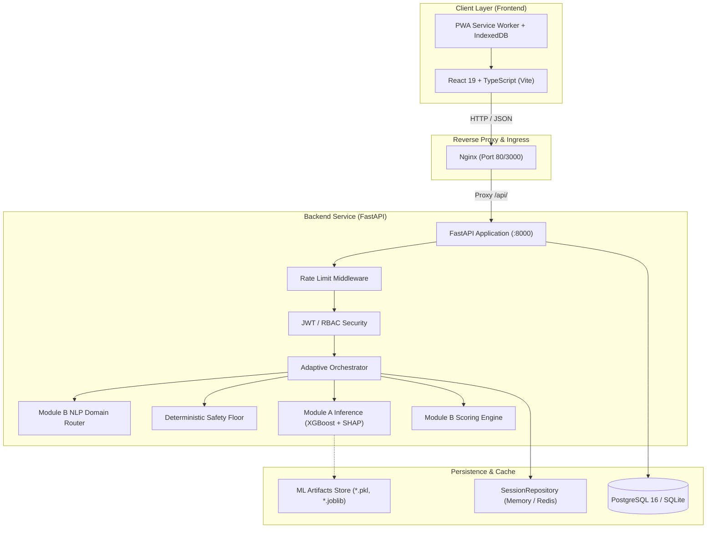

# Nirixon — AI-Assisted Pediatric Developmental Screening & Community Referral Platform

[](https://fastapi.tiangolo.com)
[](https://react.dev/)
[](https://www.typescriptlang.org/)
[](https://vitejs.dev/)
[](https://tailwindcss.com/)
[](https://python.org)
[](https://www.postgresql.org/)
[](https://opensource.org/licenses/MIT)

> **Clinical Warning & Disclaimer**  
> **Nirixon is a developmental screening and triage platform, NOT an automated diagnostic system.** It categorizes risk into actionable clinical tiers (*Typical*, *Monitor*, *Refer*) to assist caregivers and healthcare workers. A screening result never replaces formal comprehensive diagnostic evaluations by certified pediatricians, developmental pediatricians, clinical psychologists, or multidisciplinary teams.

---

## 📖 Table of Contents

1. [Executive Overview](#-executive-overview)
2. [Feature Status Table (Verified by Automated Tests)](#-feature-status-table-verified-by-automated-tests)
3. [Core Clinical Architecture & Safety Invariants](#-core-clinical-architecture--safety-invariants)
4. [Dual-Module Screening Engines](#-dual-module-screening-engines)
   - [Module A: Early Childhood Screening (0–60 Months)](#module-a-early-childhood-screening-060-months)
   - [Module B: School-Age Screener (5–12 Years)](#module-b-school-age-screener-512-years)
5. [Community Health Worker (ASHA / Anganwadi / ANM) Ecosystem](#-community-health-worker-asha--anganwadi--anm-ecosystem)
   - [Frontline Worker Dashboard](#frontline-worker-dashboard)
   - [Offline-First Progressive Web App (PWA) Architecture](#offline-first-progressive-web-app-pwa-architecture)
   - [One-Touch Referrals, WhatsApp Integration & RBSK/DEIC Handoff](#one-touch-referrals-whatsapp-integration--rbskdeic-handoff)
   - [Area-Level Data Isolation & Privacy Invariants](#area-level-data-isolation--privacy-invariants)
6. [Multi-Caregiver Triangulation & Joint Family Concordance](#-multi-caregiver-triangulation--joint-family-concordance)
7. [Longitudinal Growth & Developmental Velocity Tracking](#-longitudinal-growth--developmental-velocity-tracking)
8. [Find Help Directory & Geolocation Service](#-find-help-directory--geolocation-service)
9. [Clinician "What-If" Simulation Sandbox](#-clinician-what-if-simulation-sandbox)
10. [Multilingual Audio Narration Engine](#-multilingual-audio-narration-engine)
11. [End-to-End System Architecture](#-end-to-end-system-architecture)
12. [Complete API Reference](#-complete-api-reference)
13. [Privacy, Ethics & Regulatory Compliance (DPDPA / HIPAA)](#-privacy-ethics--regulatory-compliance-dpdpa--hipaa)
14. [Installation & Local Development](#-installation--local-development)
15. [Default Seed Credentials](#-default-seed-credentials)
16. [Docker & Containerized Deployment](#-docker--containerized-deployment)
17. [Test Suite & Quality Verification](#-test-suite--quality-verification)
18. [Known Limitations & Clinical Boundary Notices](#-known-limitations--clinical-boundary-notices)
19. [Interactive Evaluation Demo Script](#-interactive-evaluation-demo-script)
20. [Project Directory Layout](#-project-directory-layout)

---

## 🌟 Executive Overview

In low- and middle-income regions—and particularly across India and South Asia—over 70% of neurodevelopmental delays, sensory impairments, and learning disabilities are detected only after children enter primary school, missing the critical early intervention window (ages 0–5). Frontline health workers (**ASHA**, **Anganwadi**, and **ANM**) conduct massive door-to-door community surveys, but face paper-based bottlenecks, fragmented referral chains, multi-caregiver disagreement, and intermittent internet connectivity.

**Nirixon** is an open, privacy-by-design, clinical-grade developmental screening platform specifically built to bridge this divide. It couples:
- **Calibrated Machine Learning (XGBoost/LightGBM)** with local **SHAP** feature attribution.
- An **Uncompromising Deterministic Clinical Safety Floor** that overrides statistical models upon detecting developmental regression or severe milestone loss.
- An **Offline-First Progressive Web App (PWA)** for grassroots workers with automated conflict resolution and zero-PII storage.
- A **Joint Family Concordance System** that triangulates perspectives across parents, grandparents, and teachers.
- Direct operational integration with **National Health Mission (NHM)** initiatives: **RBSK** (Rashtriya Bal Swasthya Karyakram) mobile teams and **DEIC** (District Early Intervention Centres).

---

## 📊 Feature Status Table (Verified by Automated Tests)

Every feature status in Nirixon strictly reflects the verification proven by the end-to-end and integration test suites:

| Feature / Subsystem | Category | Current Status | Test Suite Verification | Architectural & Clinical Notes |
|---|---|---|---|---|
| **Early Childhood Screening (Module A)** | Screening Engine | **Live · Verified** | `tests/test_end_to_end.py::test_e2e_flow_1_module_a_screening` | 0–60m adaptive IRT-inspired questionnaire, calibrated XGBoost inference, dynamic stopping, SHAP feature attribution |
| **School-Age Screener (Module B)** | Screening Engine | **Live · Verified** | `tests/test_end_to_end.py::test_e2e_flow_2_module_b_screening`, `test_module_b_api.py` | 5–12y free-text NLP routing (TF-IDF + LogisticRegression), 8 developmental domains, 2 rule-outs, domain radar, 48 evidence-based home activities |
| **Deterministic Clinical Safety Floor** | Clinical Safety | **Live · Verified** | `tests/test_end_to_end.py::test_e2e_flow_3_safety_rule_bypass`, `test_regressions.py` | Milestone regression and severe deficit deterministic override forcing immediate Tier 3: Refer triage (overriding ML output) |
| **Clinician "What-If" Simulation Sandbox** | Clinician Tools | **Live · Verified** | `tests/test_end_to_end.py::test_e2e_flow_4_what_if_simulation`, `test_sandbox.py` | Post-hoc re-scoring via `/api/sandbox/{session_id}/simulate`, hypothetical override testing, dynamic probability & TreeSHAP shifts |
| **Community Health Worker Referral Lifecycle** | Community Health | **Live · Verified** | `tests/test_end_to_end.py::test_e2e_flow_5_referral_creation_to_outcome`, `test_referrals.py` | 5-stage auditable state machine (`created` ➔ `sent` ➔ `seen` ➔ `outcome recorded` ➔ `closed`), printable 4-field minimal PDF summary |
| **Frontline Worker Caseload Dashboard** | Community Health | **Live · No dedicated test** | *—* | Mobile-first 360px viewport, ward-wide caseload list, fast filters (tier, overdue, age), high-contrast touch targets. No frontend test covers this view yet. |
| **Offline-First Quick Actions** | Field Operations | **Live · Verified** | `tests/test_end_to_end.py::test_e2e_flow_6_offline_sync`, `frontend/src/test/offline-sync.test.ts` | CHW quick-actions (referral / contact / outcome) are queued in IndexedDB when offline and replayed through `POST /api/chw/sync` (idempotent, conflict-logged). The caseload is cached for offline viewing. Adaptive screening itself stays online. |
| **Multilingual Audio Narration** | Accessibility | **Live · Verified** | `tests/test_audio_narration.py`, `frontend/src/test/question-audio.test.tsx` | Reviewed Hindi & English clips behind a manifest review gate (`reviewed_by`, `reviewed_date`). The check-in plays the clip for each question with a real 0.8× / 1.0× speed toggle and a silent text fallback when no reviewed audio exists. |
| **Area-Level Data Isolation & Privacy Invariants** | Data Governance | **Live · Verified** | `tests/test_referrals.py`, `tests/test_end_to_end.py` | Zero cross-ward leakage; workers strictly restricted to their assigned village/ward; 100% opt-in with consent recorded; pseudonymous IDs only |
| **Multi-Caregiver Joint Family Triangulation** | Concordance | **Live · Verified** | `tests/test_share_merge.py` | Zero-login 72-hour invite links, zero-PII exposure, clinical combination rule (safety-maximized floor + statistical primary vector), Concordance Index ($0.0 - 1.0$) |
| **Longitudinal Growth & Plateau Tracking** | Growth Surveillance | **Live · Verified** | `tests/test_growth_sync.py` | Opt-in synced developmental age tracking, automated plateau alerts, right-to-erasure cascade (`DELETE /api/growth/data/{child_id}`) |
| **Find Help Directory** | Health Navigation | **Live · Verified** | `backend/tests/test_find_help.py`, `backend/tests/test_find_help_route.py`, `frontend/src/test/find-help.test.tsx` | Haversine distance lookup by 6-digit PIN code, age-stratified routing (<6y DEIC/RBSK vs 6-12y District Hospitals/CRCs), official toll-free helpline fallbacks |
| **WhatsApp Community Bot / Messaging** | Messaging / Bot | **Coming next · Roadmap** | *In Architecture Design* | Gated for lightweight automated follow-up messages; currently preserved in "Coming next" status per safety governance requirements |

---

## 🛡️ Core Clinical Architecture & Safety Invariants

### 1. Three-Tiered Triage Model
Nirixon avoids binary "normal vs abnormal" labels in favor of an actionable, stigma-reduced 3-tier clinical classification:
- **Tier 1: Typical Development** — Milestone trajectory is on track. Caregivers receive positive reinforcement and age-appropriate developmental enrichment activities.
- **Tier 2: In-App Reflex Monitor** — Borderline or isolated domain lags. Triggers structured home activities and automated follow-up surveillance (e.g. 3-month re-screening).
- **Tier 3: Priority Referral** — Significant milestone deficits or red flags. Directs families to certified pediatric developmental centres (DEICs, Civil Hospitals).

### 2. The Deterministic Safety Floor Override
Statistical ML models can occasionally suffer from false reassurance on edge cases. Nirixon implements an inviolable **Clinical Safety Floor** that sits upstream and downstream of ML inference:
- **Milestone Regression:** Any reported loss of previously mastered milestones (speech, motor, social) triggers an immediate, non-negotiable **Tier 3: Refer** override.
- **Severe Milestone Deficit:** A verified motor or cognitive delay of $\le -2.0$ Standard Deviations overrides any probabilistic score.
- **Sensory & ASD Red Flags:** Critical vision/hearing non-responsiveness or early signs of social-communication withdrawal cannot be suppressed by typical scores in other domains.

```
       Caregiver Questionnaire Responses
                       │
         ┌─────────────┴─────────────┐
         ▼                           ▼
  [ML Risk Pipeline]     [Deterministic Safety Floor]
  (Calibrated XGBoost)   (Regressions, Severe Delays, Red Flags)
         │                           │
         │                     Positive Red Flag?
         │                     ├── YES ──► [TIER 3: REFERRAL OVERRIDE]
         │                     │           (Safety Notice & RBSK/DEIC)
         │                     └── NO
         ▼                          │
  [Predicted Risk Tier] ◄───────────┘
```

### 3. Prematurity Age Correction
To prevent healthy preterm infants from being incorrectly flagged as delayed, Nirixon dynamically calculates **Corrected Age in Months**:
$$\text{Corrected Age} = \text{Chronological Age} - \left( \frac{40 - \text{Gestational Weeks at Birth}}{4.33} \right)$$
Gestational age correction applies automatically for all infants under 24 months born before 37 weeks.

---

## 🧩 Dual-Module Screening Engines

### Module A: Early Childhood Screening (0–60 Months)

Designed for early identification of global developmental delays, cerebral palsy risk, autism spectrum indicators, and sensory deficits.

* **Clinical Item Bank:** Aligned with internationally recognized milestone domains:
  1. *Communication* (receptive and expressive language)
  2. *Gross Motor* (locomotion, posture, and balance)
  3. *Fine Motor* (pincer grasp, hand-eye coordination)
  4. *Problem Solving* (exploration, cause-and-effect cognition)
  5. *Personal-Social* (self-regulation, solitary/interactive play)
* **Adaptive Question Engine:** Evaluates domain uncertainty dynamically. Rather than overwhelming a parent with 60+ static questions, the session evaluates information gain and stops early (between 8 and 20 questions) when confident, while ensuring domain coverage requirements are satisfied.
* **Calibrated Inference & SHAP Explainability:**
  - Winning model: **XGBoost Classifier** with probability calibration via Isotonic Regression.
  - Verified metrics recorded in the central claims register (`claims_register.json` and `backend/ml/artifacts/metrics.json`).
  - Every prediction yields a **SHAP local attribution waterfall**, highlighting to clinicians and parents exactly which milestone answers contributed to the triage decision.

### Module B: School-Age Screener (5–12 Years)

Tailored for neurodevelopmental, behavioural, and learning challenges that emerge in academic settings.

* **NLP Free-Text Caregiver Intake:**
  - Caregivers describe concerns in their own natural language (e.g. *"Struggles to copy from blackboard and gets easily distracted"*).
  - The **Domain Router** (`TF-IDF` + `LogisticRegression` + clinical keyword safety guards) classifies initial priors across 8 domains and detects urgent safety keywords.
  - **Zero-PII Storage:** The raw text is wiped immediately after processing; only a SHA-256 hash is retained for audit deduplication.
  - **Recall Chips:** If the text is ambiguous, the engine provides guided conversational chips (e.g., "Trouble focusing", "Reading difficulties", "Emotional outbursts").
* **8 Developmental & Educational Domains + 2 Rule-Outs:**
  1. *Attention & Work Habits* (Vanderbilt / INDT-ADHD aligned)
  2. *Emotion & School Conduct* (Strengths and Difficulties Questionnaire — SDQ)
  3. *Reading Fluency & Decoding* (DALI / NIMHANS SLD aligned)
  4. *Writing & Expression* (NIMHANS SLD aligned)
  5. *Mathematics & Numeracy* (NCERT / NIMHANS aligned)
  6. *Listening Comprehension & Speech*
  7. *Motor Coordination* (Developmental Coordination Disorder — DCDQ)
  8. *Social Participation & Peer Relations*
  - **Rule-Out 1: Sensory Triage** (Vision & Hearing rule-out checks)
  - **Rule-Out 2: Global Developmental & ASD Red Flags**
* **Acute Crisis Safety Flow:** Mentions of self-harm, extreme despair, or abuse immediately launch a dedicated safety notice displaying verified Indian toll-free crisis lines (Tele-MANAS, Kiran Mental Health Helpline, and CHILDLINE / RBSK, declared in `app/core/help_service.py` and `frontend/src/landing/helplines.ts`).
* **Evidence-Based Home Activities:** Module B returns targeted, age-stratified practice activities (48 evidence-based protocols across academic and social domains) to guide caregivers immediately while awaiting clinical appointments.

---

## 👩‍⚕️ Community Health Worker (ASHA / Anganwadi / ANM) Ecosystem

Nirixon provides a full-featured, field-tested operations portal (`/referrals`, `/chw`) built specifically for India's frontline healthcare workforce: **ASHA Workers**, **Anganwadi Workers (AWW / ICDS)**, and **Auxiliary Nurse Midwives (ANM)**.

```
       [Field Tablet / Smartphone]
                   │
    ┌──────────────┴──────────────┐
    ▼                             ▼
Online Mode                  Offline Mode
(Direct REST)            (PWA Service Worker + IndexedDB)
    │                             │
    │                    [Offline Sync Queue]
    │                             │ (Auto-reconnect)
    └──────────────┬──────────────┘
                   ▼
         POST /api/chw/sync
                   │
    ┌──────────────┴──────────────┐
    ▼                             ▼
Idempotency Check         Conflict Detection & Resolution
(UUID Keys)               (Server State vs Client Payload)
                   │
                   ▼
       [Isolated Ward Database]
```

### Frontline Worker Dashboard
- **Low-Literacy & High-Contrast Interface:** Accessible design featuring high-contrast touch targets, self-explanatory iconography, and simplified terminology for field tablets.
- **Roster Management:** Instant filtering by Village/Ward, Triage Tier, and Overdue Home Visits.
- **Home Visit Cadence:** Automated calculation of 30-day, 60-day, and 90-day follow-up schedules.

### Offline-First Progressive Web App (PWA) Architecture
Frontline workers routinely visit remote rural hamlets and congested urban settlements without cellular data:
- **Client Storage (`IndexedDB`):** Screenings, home visits, child profiles, and referral handoffs are written to the browser's persistent IndexedDB store (`nirixon_chw_offline_db`).
- **Idempotency Guarantee:** Every queued operation contains a client-generated UUID `idempotency_key`. Retrying synchronization across flaky 2G/3G connections will never create duplicate child records or split referrals.
- **Conflict Resolution Engine:** When client state diverges from server state, the server resolves conflicts using domain precedence rules and logs the audit event in the `conflict_logs` table.
- **Shared Device Security:** Multiple workers sharing a primary health center tablet can safely hand over devices: **logging out triggers an immediate, irreversible wipe (`clearAllOfflineData()`)** of all local decrypted caches.

### One-Touch Referrals, WhatsApp Integration & RBSK/DEIC Handoff
- **One-Touch Creation:** Instant conversion of a flagged screening into an official referral packet.
- **WhatsApp Direct Sharing:** Generates pre-formatted bilingual referral summaries formatted for WhatsApp Web/App, allowing immediate handoff to parents or supervisors.
- **Printable Clinical PDF Slips:** Generates clean, printer-friendly referral slips conforming to government DEIC intake documentation.
- **Strict 5-Stage Auditable Lifecycle:**
  $$\text{created} \longrightarrow \text{sent} \longrightarrow \text{seen} \longrightarrow \text{outcome recorded} \longrightarrow \text{closed}$$
  Outcomes cannot be recorded until a child is formally marked as *seen* at the health facility.

### Area-Level Data Isolation & Privacy Invariants
- **Catchment Boundary Isolation:** Workers are bound to specific administrative zones (e.g. `Ward 12`, `Rampur Village`).
- **Zero Cross-Ward Leakage:** REST endpoints enforce strict `SELECT` and `INSERT` constraints based on the authenticated worker's assigned area. Cross-ward queries return HTTP 403 Forbidden.
- **Zero-PII Child Model:**
  - Children are identified exclusively by pseudonymous tokens (e.g. `child-98f2a1b7`).
  - No child names, parental contact numbers, or exact birthdates are stored in central referral tables.
  - Age is stored strictly as a coarse bracket (e.g. `18-24m`, `24-30m`).

---

## 👨‍👩‍👧‍👦 Multi-Caregiver Triangulation & Joint Family Concordance

In South Asian and joint-family households, developmental observations often vary between mothers, fathers, grandparents, and daycare educators:
- **Zero-Login Caregiver Invites:** The primary caregiver can generate an expiring, single-use public link (`/joint-invite/{token}`) for up to 3 secondary respondents.
- **Zero PII Exposure:** The respondent sees only the specific milestone questions—never the child's demographic information, parent identity, or previous answers.
- **The Clinical Combination Rule:**
  1. **Safety Maximization:** The *most concerning answer* given across all respondents is fed into the deterministic safety floor (ensuring that a grandmother's or mother's noticed red flag is never diluted or averaged away).
  2. **Statistical Stability:** The primary caregiver's consistent responses feed the statistical ML feature vector.
- **Item-Level Concordance Metric:** The system calculates a mathematical Concordance Index ($0.0 - 1.0$) highlighting specific items with parental disagreement (e.g. *"Father reports child responds to name; Mother reports child does not"*), generating structured prompts for pediatric clinical discussions.

---

## 📈 Longitudinal Growth & Developmental Velocity Tracking

Nirixon provides an optional, opt-in synced developmental age tracking subsystem (`/growth`):
- **Developmental Age vs Chronological Age:** Calculates developmental velocity across sequential home visits.
- **The Plateau Detection Rule:** If a child's developmental trajectory plateaus (zero gain in developmental age over 3–6 chronological months), an automated alert prompts the caregiver and assigned health worker to schedule an early clinical reassessment.
- **Full Right to Erasure:** In strict adherence to India's **DPDPA 2023** and **GDPR**, caregivers can trigger complete, permanent deletion of their child's longitudinal history at any time (`DELETE /api/growth/data/{child_id}`).
- **Data Portability:** Full JSON export of growth trajectories (`GET /api/growth/export/{child_id}`) without proprietary lock-in.

---

## 🏥 Find Help Directory & Geolocation Service

Nirixon features a directory of verified public and charitable developmental health centers across India:
- **Verified Facility Types:**
  - **DEIC (District Early Intervention Centres)** under the National Health Mission.
  - **RBSK (Rashtriya Bal Swasthya Karyakram)** Mobile Pediatric Health Teams.
  - **Civil & District Hospitals** with specialized pediatric departments.
  - **Composite Regional Centres (CRC)** & National Apex Institutes (e.g., NIEPID, NIMHANS, AIIPMR).
  - Child Development & Early Childhood Intervention Clinics.
- **Geospatial Lookup:** Instant query via **6-digit Indian Postal PIN Code** or **GPS Coordinates** (using Haversine distance sorting).
- **Strict Clinical Age Routing:**
  - Children **under 6 years** are routed to DEICs and RBSK teams.
  - Children **ages 6 to 12** are routed to District Hospital pediatric units, CRCs, and specialized educational rehabilitation centers (as DEICs officially cater only up to age 6).
- **National Emergency Fallbacks:** When no verified facility exists within radius, the system immediately returns verified toll-free helplines (Tele-MANAS, Kiran Mental Health Helpline, and CHILDLINE / RBSK, declared in `app/core/help_service.py` and `frontend/src/landing/helplines.ts`) alongside district health office directives.

---

## 🔬 Clinician "What-If" Simulation Sandbox

For developmental pediatricians, psychologists, and clinical researchers, Nirixon includes an advanced simulation environment (`/sandbox`, `/deferred/clinician-sandbox`):
- **Hypothetical Override Testing:** Load any completed screening session and re-run inference under modified conditions (e.g. *"What if the family history flag were positive?"* or *"What if gross motor score drops by 1 point?"*).
- **Live Model Comparison:** Compare predictions and calibration probabilities between XGBoost, Random Forest, and baseline Logistic Regression models.
- **Real-Time SHAP Shifts:** Observe how individual answer changes dynamically alter the global and local SHAP feature attribution values.

---

## 🎙️ Multilingual Audio Narration Engine

To guarantee equity across diverse literacy levels and regional linguistic communities, Nirixon includes a pre-recorded audio narration engine (`/api/audio/*`):
- **Languages Supported / Ready:** English, Hindi (हिन्दी), Tamil (தமிழ்), Telugu (తెలుగు), Bengali (বাংলা), Marathi (मराठी).
- **Strict Clinical Verification Gate:** Unreviewed audio files are strictly hidden by default. An audio file can only be served if it possesses an explicit `reviewed_by` and `reviewed_date` recorded by a certified pediatric or linguistic specialist.
- **Zero Unverified AI Translation:** Runtime machine translation or unverified synthetic text-to-speech for clinical questions is strictly prohibited to prevent mistranslations that could alter clinical diagnostic sensitivity.

---

## 🏗️ End-to-End System Architecture



---

## 📡 Complete API Reference

Interactive Swagger documentation is available at `http://localhost:8000/docs` when running the backend.

### Authentication & Users
| Method | Endpoint | Access | Description |
|---|---|---|---|
| `POST` | `/api/auth/login` | Public | Authenticate user (parent, chw, supervisor, clinician) & receive JWT. |

### Screening Core (Modules A & B)
| Method | Endpoint | Access | Description |
|---|---|---|---|
| `POST` | `/api/screen/start` | Parent | Initialize a new adaptive screening session with explicit consent. |
| `POST` | `/api/screen/{id}/intake` | Parent | Submit free-text concern (Module B) for NLP domain routing. |
| `POST` | `/api/screen/{id}/recall-choice`| Parent | Select guided recall chip if free-text concern was ambiguous. |
| `POST` | `/api/screen/{id}/answer` | Parent | Submit answer to pending item; returns next adaptive action. |
| `GET` | `/api/screen/{id}/result` | Parent | Fetch completed triage result, domain breakdown, and SHAP factors. |
| `GET` | `/api/screen/{id}` | Parent | Inspect session state and audit metadata. |
| `POST` | `/api/predict` | Parent | Standalone inference endpoint for raw feature vectors. |

### Community Health Worker (CHW) System
| Method | Endpoint | Access | Description |
|---|---|---|---|
| `GET` | `/api/chw/workers/me` | Worker | Fetch profile and assigned village/ward of authenticated worker. |
| `POST` | `/api/chw/children` | Worker | Register pseudonymous child record with explicit caregiver consent. |
| `GET` | `/api/chw/children` | Worker | Query child roster within worker's assigned area (supports tier filters). |
| `GET` | `/api/chw/children/{id}` | Worker | Fetch child profile, follow-up dates, and flag summaries. |
| `DELETE`| `/api/chw/children/{id}` | Worker | Erase child record and purge associated referrals (Right to Erasure). |
| `POST` | `/api/chw/children/{id}/contact` | Worker | Log completed home visit contact and update follow-up cadence. |
| `POST` | `/api/chw/children/{id}/outcome` | Worker | Record post-referral evaluation findings and update triage tier. |
| `POST` | `/api/chw/children/{id}/one-touch-referral` | Worker | Fast-track one-click referral generation. |
| `POST` | `/api/referrals` | Worker | Create formal clinical referral to DEIC or health facility. |
| `GET` | `/api/referrals` | Worker | List referrals within assigned area with status filtering. |
| `PATCH`| `/api/referrals/{id}` | Worker | Update referral status (`sent`, `seen`, `outcome recorded`, `closed`). |
| `GET` | `/api/referrals/{id}/summary` | Worker | Export minimal 4-field referral summary (JSON, PDF, shareable text). |
| `POST` | `/api/chw/sync` | Worker | Batch sync offline-queued actions with idempotency keys & conflict handling. |

### Multi-Caregiver Triangulation (Joint Family)
| Method | Endpoint | Access | Description |
|---|---|---|---|
| `POST` | `/api/share/invite` | Parent | Generate an expiring, single-use respondent link for a relative/teacher. |
| `GET` | `/api/share/invite/{token}` | Public | Fetch questionnaire items for secondary respondent (zero PII exposed). |
| `POST` | `/api/share/respond/{token}`| Public | Submit responses from secondary caregiver. |
| `GET` | `/api/share/concordance/{id}` | Parent | Calculate item-level Concordance Index and list parenting disagreements. |
| `POST` | `/api/share/merge/{id}` | Parent | Execute combination rule (safety floor gets worst-case; ML gets primary). |

### Longitudinal Growth Tracking
| Method | Endpoint | Access | Description |
|---|---|---|---|
| `GET` | `/api/growth/status` | Public | Verify server growth syncing status and privacy constraints. |
| `POST` | `/api/growth/visits` | Parent | Record an opt-in pseudonymous growth visit snapshot. |
| `GET` | `/api/growth/visits/{child_id}`| Parent | List longitudinal history for a pseudonymous child ID. |
| `GET` | `/api/growth/analysis/{child_id}`| Parent | Compute developmental velocity and evaluate Plateau Rule. |
| `GET` | `/api/growth/export/{child_id}` | Parent | Export portable JSON record of all visits and velocity metrics. |
| `DELETE`| `/api/growth/data/{child_id}` | Parent | Permanently purge all server-stored growth data for child. |

### Healthcare Directory & Geolocation
| Method | Endpoint | Access | Description |
|---|---|---|---|
| `GET` | `/api/help/nearby` | Public | Find nearest verified DEICs, RBSK units, or Hospitals by PIN or GPS. |

### Clinician Sandbox
| Method | Endpoint | Access | Description |
|---|---|---|---|
| `POST` | `/api/sandbox/{id}/simulate` | Clinician | Re-score session with hypothetical overrides and compare ML models. |

### Audio Narration & Accessibility
| Method | Endpoint | Access | Description |
|---|---|---|---|
| `GET` | `/api/audio/item/{id}` | Public | Retrieve verified audio narration metadata for an item and language. |
| `GET` | `/api/audio/manifest` | Public | Fetch entire reviewed audio catalog for offline preloading. |
| `GET` | `/api/audio/coverage-report` | Public | Audit clinical audio coverage across languages and milestone banks. |

### System Health & Telemetry
| Method | Endpoint | Access | Description |
|---|---|---|---|
| `GET` | `/health` | Public | Inspect status of Database, Module A ML artifacts, and Module B engine. |
| `GET` | `/live` | Public | Basic process liveness probe. |

---

## 🔒 Privacy, Ethics & Regulatory Compliance (DPDPA / HIPAA)

Nirixon was architected from inception to meet India's **Digital Personal Data Protection Act (DPDPA 2023)**, **ICMR Guidelines for Biomedical Research Involving Children**, and international **HIPAA** principles.

1. **No Real PII in Screening Tables:** Children are referenced solely by cryptographic UUIDs or tokens (e.g. `child-c9f1a238`). Exact birthdates are prohibited; children are grouped into broad developmental brackets (`18-24m`, `24-30m`).
2. **Explicit, Timestamped Consent:** No screening, growth sync, or community referral can begin without active, recorded caregiver opt-in consent (`consent_recorded_at`).
3. **Right to Erasure (DPDPA Sec. 12):** Caregivers retain unconditional control. Deleting a child's record irreversibly purges screening answers, risk assessments, referrals, and growth visits via cascading database triggers.
4. **Minimal Referral Handoff Standard:** The generated referral summary transmitted to external specialists or clinics contains **strictly four non-identifying fields**:
   - Age Bracket (e.g., `18-24m`)
   - Triage Tier (e.g., `Tier 3: Direct Referral`)
   - Domains of Concern (e.g., `['motor', 'communication']`)
   - Triggered Safety Rule (e.g., `'Loss of motor milestones (SD <= -2.0)'`)
5. **Ephemerality of Free-Text Concerns:** Caregiver raw text descriptions submitted to Module B are processed in-memory by the NLP tokenizer and discarded immediately. Only a SHA-256 hash is retained for idempotent request deduplication.
6. **In-Memory JWT Storage:** In the web application, authentication tokens are maintained strictly in browser memory, preventing persistent session hijacking and token theft.

---

## 💻 Installation & Local Development

### Prerequisites
- **Python:** 3.10, 3.11, or 3.12
- **Node.js:** v18.0.0 or higher (v20+ recommended)
- **Package Manager:** `npm` (or `pnpm` / `yarn`)
- **Docker & Docker Compose:** *(Optional, for containerized run)*

---

### Step 1: Clone Repository & Configure Environment

```bash
git clone https://github.com/your-org/nirixon.git
cd nirixon

# Copy environment template
cp .env.example .env
```

Review `.env` settings. The default configuration uses an asynchronous SQLite database (`nirixon_dev.db`), which requires no external database service:
```ini
ENVIRONMENT=development
DATABASE_URL=sqlite+aiosqlite:///./backend/nirixon_dev.db
JWT_SECRET=dev-only-change-me
SESSION_REPO_BACKEND=memory
ML_ARTIFACTS_DIR=backend/ml/artifacts
RATE_LIMIT_ENABLED=true
```

---

### Step 2: Backend Setup & ML Artifact Generation

```bash
# Create and activate Python virtual environment
python -m venv .venv

# On Linux/macOS:
source .venv/bin/activate
# On Windows (PowerShell):
.venv\Scripts\Activate.ps1

# Install backend dependencies & ML libraries
pip install -r backend/requirements-ml.txt -r backend/requirements.txt

# Train Module A calibrated ML model and generate artifacts
cd backend/ml
python train.py
cd ../..

# Apply database schema migrations via Alembic
cd backend
alembic upgrade head
cd ..
```

---

### Step 3: Run the FastAPI Backend Service

```bash
cd backend
uvicorn app.main:app --reload --port 8000 --workers 1
```
*The API is now live at `http://localhost:8000`. Test `/health` to confirm database and ML artifacts are loaded.*

> 💡 **Session Persistence & Multi-Worker Clustering**  
> - For local development, `SESSION_REPO_BACKEND=memory` runs `InMemorySessionRepo` (single-worker process).  
> - For production or multi-worker clustering (`--workers 4` or multiple API replicas), set `SESSION_REPO_BACKEND=redis` and `REDIS_URL=redis://localhost:6379/0`. `RedisSessionRepo` persists serialized screening sessions with automatic TTL expiration (default 24 hours) and instant cross-worker cache invalidation.

---

### Step 4: Frontend Setup & Local Development Server

In a new terminal window:

```bash
cd frontend

# Create frontend environment file
cp .env.example .env

# Install dependencies
npm install

# Start Vite development server
npm run dev
```

*The parent-facing application and CHW portal are now accessible at `http://localhost:5173`.*

---

## 🔑 Default Seed Credentials

During application startup, Nirixon automatically seeds standard accounts for testing and evaluation across all user personas:

| Persona / Role | Email | Password | Role Key | Assigned Territory / Notes |
|---|---|---|---|---|
| **Parent / Caregiver** | `parent@example.com` | `changeme` | `parent` | Standard family screening flow |
| **Frontline CHW (ASHA)** | `chw@example.com` | `changeme` | `chw` | Assigned to **Ward 12** (Sunita Devi) |
| **Field Supervisor** | `supervisor@example.com` | `changeme` | `supervisor` | Oversees **Ward 12** (Rekha Sharma) |
| **Frontline CHW (Ward 15)**| `chw_ward15@example.com` | `changeme` | `chw` | Assigned to **Ward 15** (Anjali Kumari — for cross-area testing) |
| **Clinician / Pediatrician**| `clinician@example.com` | `changeme` | `internal` | Unlocks What-If Simulation Sandbox |

---

## 🐳 Docker & Containerized Deployment

Nirixon includes a multi-container Docker Compose configuration for production-like local testing:

```bash
cd docker
docker compose up --build
```

### Services Started:
1. **`db`:** PostgreSQL 16 Alpine with persistent volume `nirixon_pg` on port `5432`.
2. **`api`:** FastAPI backend running on port `8000`. Executes Alembic migrations automatically on boot before launching Uvicorn.
3. **`frontend`:** Production-optimized Nginx container serving compiled static assets on port `3000` and reverse-proxying `/api/` traffic directly to the backend.

Access the complete containerized stack at `http://localhost:3000`.

---

## 🧪 Test Suite & Quality Verification

Nirixon enforces automated testing across both backend Python modules and frontend React components.

### 1. Backend Pytest Suite
From the `backend/` directory:

```bash
cd backend
python -m pytest tests/test_adaptive_logic.py tests/test_api.py -v -k "not HTTP and not Sensitivity"
```

To run the comprehensive test suite across all sub-systems (referrals, growth sync, audio, joint family, module B):

```bash
cd backend
pytest tests/test_referrals.py tests/test_growth_sync.py tests/test_module_b_api.py tests/test_share_merge.py tests/test_help.py -v
```

### 2. Frontend Vitest & TypeScript Verification
From the `frontend/` directory:

```bash
cd frontend

# Run unit and integration tests (Vitest)
npm test

# Run strict TypeScript typechecking
npm run typecheck

# Verify production production bundle build
npm run build
```

---

## ⚠️ Known Limitations & Clinical Boundary Notices

Nirixon is engineered for transparent, responsible healthcare AI deployment. Evaluators, clinicians, and researchers should note the following explicit system boundaries:

### 1. Synthetic & Semi-Synthetic Training Data
The machine learning models (calibrated XGBoost for Module A and TF-IDF NLP classifier for Module B) were trained and evaluated on synthetic and semi-synthetic developmental milestone distributions calibrated to peer-reviewed epidemiological prevalence rates (e.g., CDC, WHO, and Indian National Family Health Survey benchmarks). 
- While internal validation confirms high discriminative capability on held-out synthetic cohorts, prospective clinical validation across diverse socioeconomic, nutritional, and regional strata across India remains ongoing.
- Models must not be treated as a definitive diagnostic instrument.

### 2. Clinical Review Pending (Screening vs Diagnostic Device)
Nirixon is strictly categorized as an **AI-assisted developmental screening and triage decision-support tool (Section 0.5 guidelines)**.
- It is **NOT** an automated diagnostic device, software as a medical device (SaMD), or a replacement for comprehensive clinical examination.
- Every triage recommendation (*Typical*, *Monitor*, *Refer*) requires clinical correlation by certified healthcare professionals (pediatricians, developmental specialists, or trained district health officers).
- Multi-site clinical trial protocols (`docs/pilot_study_protocol.md`) are currently formulated for institutional ethical review (IRB/IEC).

### 3. Module B Domain Precision Trade-Off
School-age parental free-text intake presents unique natural language challenges:
- The domain router achieves fine-grained domain precision and recall trade-offs documented in `claims_register.json` and `backend/ml/artifacts/module_b_router/router_metrics.json` (due to colloquial overlap between attention vs sensory vs learning descriptions in informal caregiver notes).
- **Clinical Mitigation Architecture:** Nirixon intentionally tunes the router for higher recall over precision so potential concerns are not missed. Any domain routed with borderline certainty is followed by targeted, adaptive micro-testing items and explicit sensory rule-outs.
- Crucially, the **acute crisis and safety rule router maintains 100% safety recall** on emergency, self-harm, and milestone loss signals, guaranteeing that critical red flags trigger immediate referral regardless of domain classification nuance.

---

## 🎬 Interactive Evaluation Demo Script

Follow this step-by-step walkthrough to reproduce every verified capability in Nirixon:

### Scenario 1: Early Childhood Screening (Module A — 18 Months)
1. **Navigate to the Screening Portal:** Open `http://localhost:5173/screen` and log in as `parent@example.com` / `changeme`.
2. **Initialize Screening:** Select child age as **18 months**, toggle **Premature: No**, accept the opt-in **Consent Notice**, and select **Module A (0–60 Months)**.
3. **Audio Narration Bar:** Note the pre-recorded audio narration widget at the top. Click play to hear the verified Hindi or English prompt. Toggle playback speed between `0.8x` and `1.0x`.
4. **Adaptive Milestone Questions:** Answer the developmental milestone questions (Communication, Fine Motor, Problem Solving). Note that questions adapt dynamically based on previous responses.
5. **Results & SHAP Waterfall:** Upon completion, observe the **Tier 1: Routine Pass** or **Tier 2: In-App Monitor** triage badge, along with domain score bars, TreeSHAP contribution factors, and home play activities.

### Scenario 2: School-Age Screener with Free-Text NLP (Module B — 8 Years)
1. **Start School-Age Session:** Return to `/screen` and choose **Module B (5–12 Years)**.
2. **Enter Caregiver Concern:** In the free-text intake textarea, type:  
   *"Teacher says he cannot sit still, gets easily distracted during class, and struggles with reading new words."*
3. **NLP Routing & Recall Chips:** The router automatically highlights **Attention & Work Habits** and **Reading Fluency** as initial priors.
4. **Adaptive Micro-Testing:** Answer the targeted micro-testing items.
5. **Radar & Activities:** Review the 8-domain radar chart visualizing domain scores, alongside evidence-based home activities for attention and decoding.

### Scenario 3: Deterministic Clinical Safety Floor & Crisis Bypass
1. **Trigger Safety Floor:** In Module A, answer a question indicating **developmental regression** (e.g., child previously had words and walked independently, but has now stopped speaking and lost motor coordination).
2. **Deterministic Override:** Notice that regardless of typical scores in other domains, the system immediately halts the session and issues a **Tier 3: Priority Referral** override.
3. **Emergency Notice:** The screen presents emergency helpline cards (Kiran, Tele-MANAS, Childline) and advises immediate clinical evaluation at the nearest DEIC.

### Scenario 4: Clinician "What-If" Simulation Sandbox
1. **Log in as Clinician:** Sign out and log in as `clinician@example.com` / `changeme`.
2. **Open Sandbox:** Navigate to `/sandbox` or click **Clinician Toolkit** from the landing page.
3. **Load Completed Session:** Select the previously completed screening session.
4. **Simulate Answer Perturbation:** Use the What-If sliders to modify an answer from *Yes* to *Not Yet*.
5. **Observe Real-Time Shift:** Click **Simulate**. The API re-scores the model instantly, showing the calibrated probability change, triage tier shift, and updated SHAP feature attribution waterfall.

### Scenario 5: Frontline Worker Low-Literacy Dashboard (ASHA / Anganwadi)
1. **Log in as Frontline CHW:** Sign in as `chw@example.com` / `changeme` (assigned to **Ward 12**).
2. **Access Dashboard:** Navigate to `/referrals` or `/chw`.
3. **Filter Village Roster:** The dashboard lists every child in Ward 12 (empty until children are registered or screened).
4. **Test Quick Filters:**
   - Click the **Tier 3** badge to isolate high-risk children.
   - Click the **Overdue Follow-Up** chip to view children pending a 30-day home check.
   - Resize your browser window to **360px width** (mobile emulation): verify zero horizontal scrolling and large touch targets.
5. **One-Touch Referral Lifecycle:**
   - Tap **Refer to DEIC** on an unscreened or Tier 2 child.
   - Fill the minimal referral modal and click **Create Referral** (status becomes `created`).
   - Advance status: Tap **Mark Sent** (status `sent`), then **Mark Seen** (status `seen`).
   - Tap **Record Outcome**: Enter diagnostic confirmation (e.g., "Enrolled in DEIC Speech Therapy") and click Save (status `outcome recorded`, then `closed`).
   - Click **Generate Printable Summary**: Verify the clean one-page PDF/text summary containing strictly the 4 allowed fields (`age_bracket`, `tier`, `domains_of_concern`, `safety_rule_trigger`).

### Scenario 6: Offline PWA Field Mode & Idempotent Sync
1. **Go Offline:** Open Chrome DevTools > Network tab > check **Offline** (or toggle Wi-Fi off).
2. **Perform Offline Field Operations:**
   - In the CHW dashboard, click **Add Child**: Register a new child (`age_bracket: 24-30m`, consent checked). Notice the yellow offline badge: *"Saved to IndexedDB offline queue"*.
   - Tap **Refer to DEIC** on the newly registered offline child.
3. **Verify IndexedDB:** In DevTools > Application > IndexedDB > `nirixon-chw-offline-db`, inspect the `sync_queue` table to see the queued operations with client UUID idempotency keys.
4. **Reconnect & Sync:** In DevTools > Network tab > uncheck **Offline**. Click **Sync Now** (or let auto-sync trigger).
5. **Verify Idempotency:** The queue synchronizes all operations to `/api/chw/sync`. Click **Sync Now** again: confirm 0 duplicate records created, and verify server processed count reflects clean deduplication.
6. **Device Handover Security:** Click **Logout**: verify that IndexedDB tables and CacheStorage are completely wiped, leaving zero child data on the device.

---

## 📁 Project Directory Layout

```
nirixon/
├── .env.example                 # Root configuration template
├── README.md                    # This comprehensive documentation guide
├── docker/                      # Deployment container specifications
│   ├── Dockerfile.backend       # Multi-stage Python 3.11 container
│   ├── Dockerfile.frontend      # Multi-stage Vite build + Nginx container
│   ├── docker-compose.yml       # Production stack: Postgres 16 + FastAPI + Nginx
│   └── nginx.conf               # SPA routing & API proxy rules
├── docs/                        # Architectural documentation & specifications
│   ├── ETHICS_AND_DATA.md       # Privacy, DPDPA 2023 & Consent governance
│   ├── AUDIO_COVERAGE_REPORT.md # Multi-dialect audio audit logs
│   ├── module_b_integration.md  # 5-12 School-age integration mapping
│   └── pilot_study_protocol.md  # Clinical field pilot protocol
├── backend/                     # FastAPI Application Service
│   ├── alembic.ini              # Database migration configuration
│   ├── requirements.txt         # Core API dependencies (FastAPI, SQLAlchemy)
│   ├── requirements-ml.txt      # Machine learning dependencies (XGBoost, SHAP)
│   ├── app/
│   │   ├── main.py              # Application entrypoint & lifespan events
│   │   ├── config.py            # Pydantic BaseSettings & env validation
│   │   ├── auth.py              # JWT authentication & password hashing
│   │   ├── core/                # Core screening, triage & referral services
│   │   │   ├── adaptive_tree.py # Dynamic item selection engine
│   │   │   ├── safety_floor.py  # Deterministic clinical safety floor
│   │   │   ├── nlp_router.py    # Free-text concern classifier
│   │   │   ├── worker_service.py# Community worker directory & logic
│   │   │   ├── referral_service.py # Lifecycle & PDF/WhatsApp formatting
│   │   │   ├── joint_family.py  # Multi-caregiver concordance & combination
│   │   │   ├── growth.py        # WHO milestone velocity & plateau checks
│   │   │   └── module_b/        # School-age questionnaire engine
│   │   ├── db/                  # Persistence layer
│   │   │   ├── models.py        # SQLAlchemy 2.0 ORM models
│   │   │   ├── session.py       # Async engine & session lifecycle
│   │   │   └── session_repo.py  # SessionRepository interface (Memory/Redis)
│   │   ├── ml/                  # ML Inference wrappers
│   │   │   └── inference_service.py # Model loading, feature vectorization, SHAP
│   │   ├── routers/             # FastAPI REST Routers
│   │   │   ├── auth.py          # Session auth endpoints
│   │   │   ├── screen.py        # Adaptive screening endpoints
│   │   │   ├── referrals.py     # CHW & referral operations
│   │   │   ├── growth.py        # Synced growth tracking
│   │   │   ├── help.py          # Geolocation & DEIC search
│   │   │   ├── share.py         # Multi-caregiver invite & concordance
│   │   │   ├── sandbox.py       # Clinician what-if simulation
│   │   │   └── audio.py         # Audio narration & coverage endpoints
│   │   └── schemas/             # Pydantic v2 validation models
│   ├── ml/                      # Machine learning training pipeline
│   │   ├── train.py             # Model training, calibration, fairness checks
│   │   ├── columns.py           # Feature matrix definitions
│   │   ├── models/              # XGBoost, LightGBM, LogisticRegression models
│   │   ├── evaluation/          # AUPRC, AUROC, ablation & fairness metrics
│   │   └── artifacts/           # Serialized model.pkl, shap_explainer.pkl
│   └── tests/                   # Pytest automated test suites
└── frontend/                    # Vite + React 19 Frontend
    ├── package.json             # NPM dependencies & scripts
    ├── vite.config.ts           # Vite configuration & dev server proxy
    ├── src/
    │   ├── App.tsx              # Root router & workspace shell
    │   ├── store.tsx            # App context: auth, routing, data loading, toasts
    │   ├── api/                 # Typed fetch API client
    │   ├── auth/                # Role definitions
    │   ├── views/               # Workspace views: Home, CheckIn, Growth, Caseload,
    │   │                        #   FindHelp, Share, Cases, ClinicalReview, WhatIf …
    │   ├── components/          # Reusable UI components & layout
    │   ├── lib/                 # Domain model, hash router, API adapters
    │   ├── landing/             # Public landing page with live interactive demo
    │   └── test/                # Vitest + React Testing Library tests
```

---

## 📜 Ethical Commitment & Open Science

Nirixon was developed with the firm conviction that **every child deserves timely developmental support regardless of geography, family structure, or economic standing**. 

Contributions, clinical feedback, and collaborative research initiatives are welcomed. For clinical protocol inquiries, ethical review partnerships, or pilot deployments with public health authorities, please refer to [`docs/ETHICS_AND_DATA.md`](docs/ETHICS_AND_DATA.md) and [`docs/pilot_study_protocol.md`](docs/pilot_study_protocol.md).

---

*Nirixon — Ensuring every developmental milestone is recognized, supported, and nurtured.*
